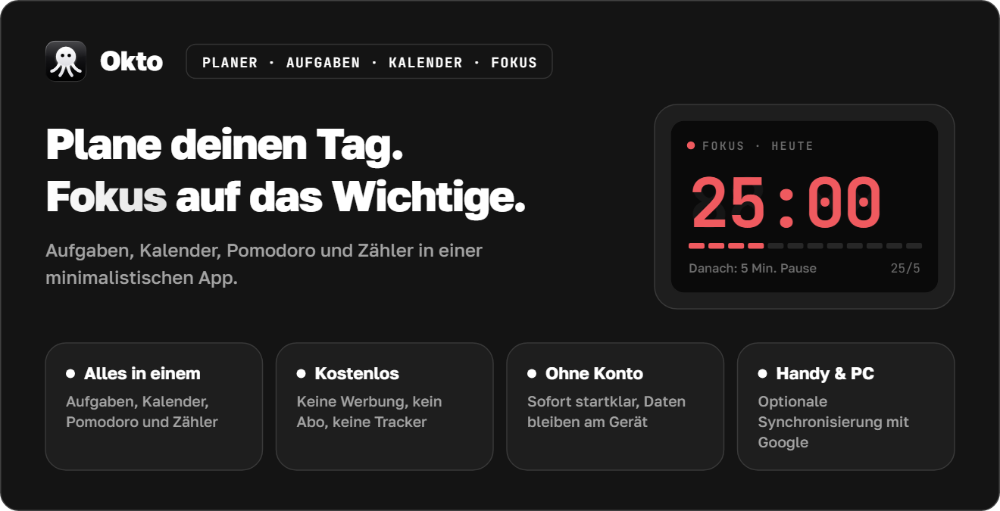
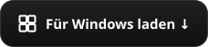
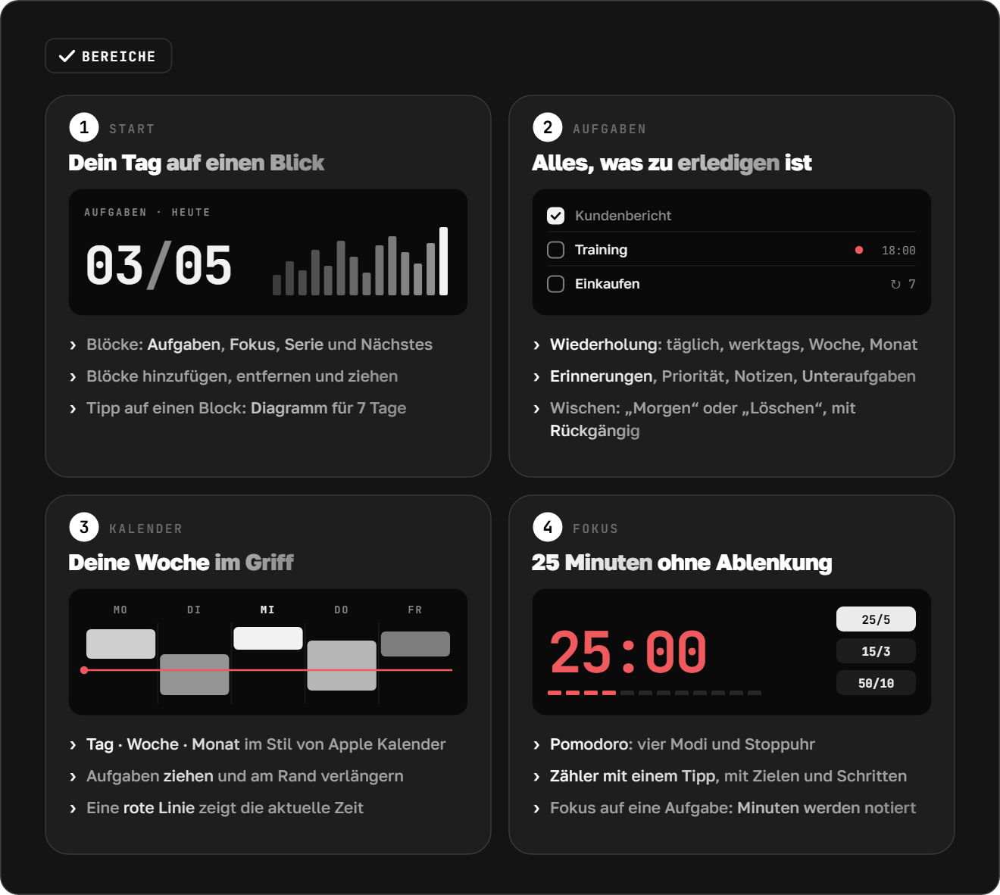
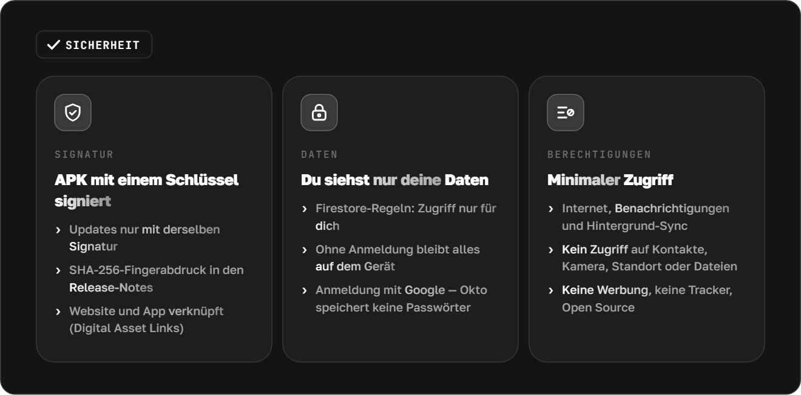

[English](README.md) · [العربية](README.ar.md) · [简体中文](README.zh-CN.md) · [繁體中文](README.zh-TW.md) · [Čeština](README.cs.md) · [Français](README.fr.md) · **Deutsch** · [Ελληνικά](README.el.md) · [Bahasa Indonesia](README.id.md) · [Gaeilge](README.ga.md) · [Italiano](README.it.md) · [日本語](README.ja.md) · [한국어](README.ko.md) · [Polski](README.pl.md) · [Română](README.ro.md) · [Русский](README.ru.md) · [Español](README.es.md) · [Українська](README.uk.md) · [اردو](README.ur.md) · [ئۇيغۇرچە](README.ug.md) · [Tiếng Việt](README.vi.md) · [Português](README.pt.md) · [Türkçe](README.tr.md)

 

<picture><source srcset="assets/readme/hero-de.svg"></picture>

&nbsp;&nbsp;&nbsp;&nbsp;

**Okto läuft auf jedem Gerät** — iPhone und Android, Tablets, Windows, macOS und Linux. Ein Browser genügt, auf Handy und Computer lässt sich Okto als App installieren. Für Android gibt es zusätzlich eine App mit Aufgaben-Widget — auch im [Komi Store](https://github.com/komi-store/komi-store).

> [!NOTE]
> Die App-Oberfläche gibt es auf Russisch und Englisch.

 

 

<picture><source srcset="assets/readme/sections-de.svg"></picture>

 

Synchronisierung einschalten

Standardmäßig speichert Okto alles im Browser des Geräts. Für dieselben Daten auf Handy und Computer ein kostenloses Firebase-Projekt verbinden (Spark-Tarif, keine Karte nötig):

1. Projekt auf [console.firebase.google.com](https://console.firebase.google.com/) anlegen.
2. **Authentication → Sign-in method** — **Google** aktivieren. Unter **Settings → Authorized domains** `sailxx-apps.github.io` hinzufügen.
3. **Firestore Database** — Datenbank anlegen und [`firestore.rules`](firestore.rules) im Tab **Rules** einfügen.
4. **Project settings → Your apps → Web** — App registrieren und `apiKey`, `authDomain`, `projectId`, `appId` kopieren.
5. Im GitHub-Repo: **Settings → Secrets and variables → Actions** — die Secrets `VITE_FIREBASE_API_KEY`, `VITE_FIREBASE_AUTH_DOMAIN`, `VITE_FIREBASE_PROJECT_ID`, `VITE_FIREBASE_APP_ID` anlegen.
6. Deploy starten. In den Einstellungen von Okto erscheint „Mit Google anmelden“.

Diese Schlüssel sind nicht geheim: Den Zugriff schützen die Firestore-Regeln, jeder sieht nur seine eigenen Daten. Erinnerungen auf der Website kommen, solange der Tab offen ist. In der Android-App kommen Erinnerungen auch bei geschlossenem Okto.

 

<picture><source srcset="assets/readme/safe-de.svg"></picture>

 

## Über Okto

<picture><source srcset="assets/readme/about-de.svg"></picture>

Okto begann am 2. Oktober 2026 als einfacher Webzähler. Daraus wurde ein kostenloser Planer für Aufgaben, Kalender und Fokus. Es gibt keine Werbung, Analysen oder Tracker. Deine Einträge bleiben auf deinem Gerät. Die Synchronisierung über Google Firebase ist optional. [Sicherheit: Signatur, Daten, Berechtigungen](PRIVACY.md)

## Roadmap

<picture><source srcset="assets/readme/roadmap-de.svg"></picture>

**2026-10-02** — Die erste Version war ein Ein-Tipp-Zähler mit Ziel und Stoppuhr.

**1.0** — Pomodoro mit vier Modi, farbige Vorlagen-Tags, sieben Designs, Englisch, Browser-Benachrichtigungen.

**2.0** — Aufgaben mit Listen, Wiederholungen, Unteraufgaben und Erinnerungen; Kalender im Stil von Apple Kalender mit Drag & Drop; anpassbarer Start; Synchronisierung über Firebase; Fokus auf eine Aufgabe.

**2.1** — Android-App mit Aufgaben-Widget für den Startbildschirm; sanfte helle und dunkle Themes im Apple-Stil; Anrufe und Fokus ausblendbar; Sprache in den Einstellungen; Start unter Android behoben.

**2.2–2.8** — App-Symbol wählbar; Fotos und Dateien in Aufgaben, Offline-Start; einklappbarer Monat im Kalender; Aufgaben-Erinnerungen unter Android; Aufgaben im Google Kalender; 14 neue helle und dunkle Themes; Textgröße und drei neue Widgets; Aktivitätskarte auf der Startseite.

**3.0** — Bereich „Notizen“ mit Fotos und Dateien; neue Startseite mit weichen, farbigen Karten und Tabs Heute / Woche / Gesamt; schwebende Navigationsleisten und einklappbare Seitenleiste am Desktop; Einstellungen mit einklappbaren Bereichen; überarbeiteter Fokus; Widget-Korrekturen unter Android.

[**3.23.6**](https://github.com/sailxx/Okto/releases/tag/v3.23.6) — Okto bekam eine Windows-App für den Infobereich. Der Android-Planer startet offline. Version 3.23.6 verbessert Anhänge und den Fokusbildschirm.

## ⚖️ Lizenzen

Die Schrift [Inter](https://rsms.me/inter/) steht unter der SIL Open Font License 1.1. Die README-Bilder sind in [JetBrains Mono](https://github.com/JetBrains/JetBrainsMono) (OFL 1.1) + [Golos Text](https://github.com/googlefonts/golos-text) (OFL 1.1) gesetzt.
