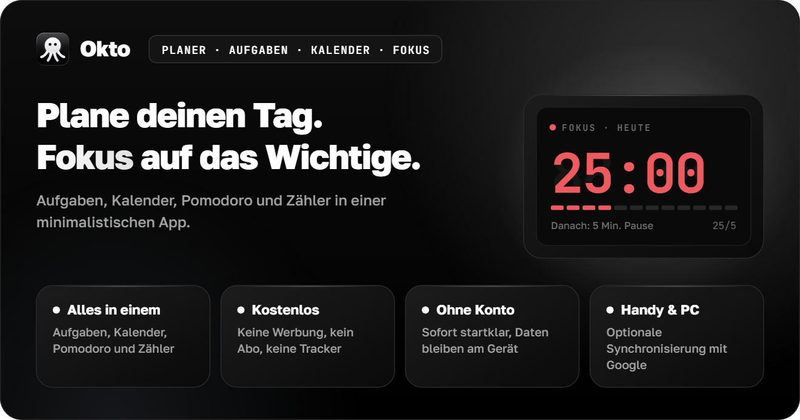
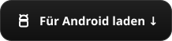
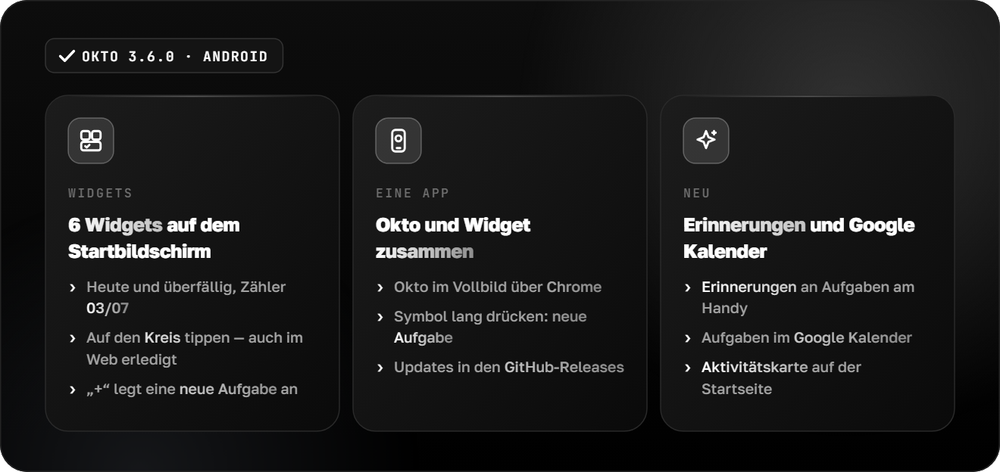
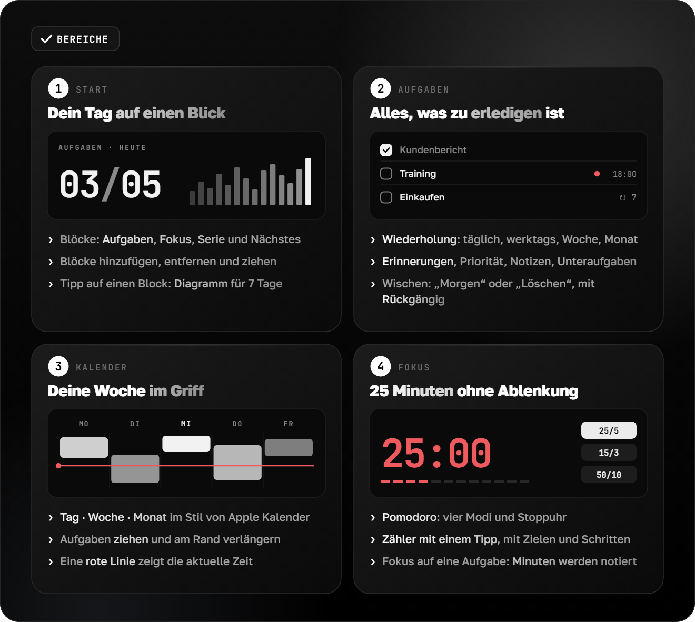
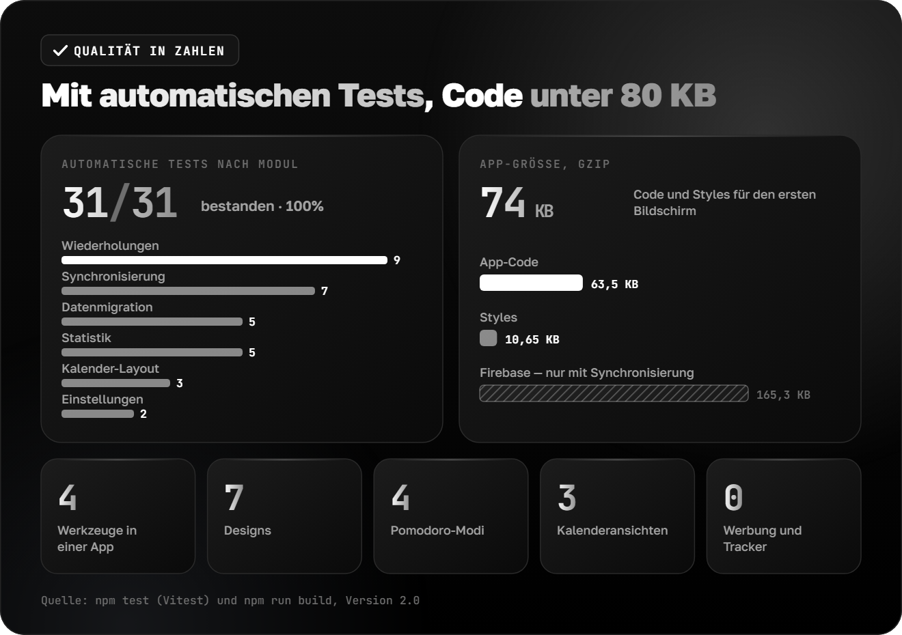
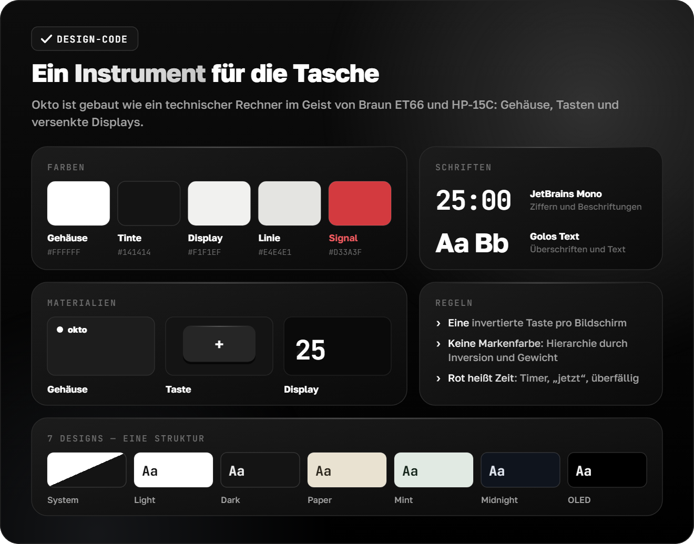
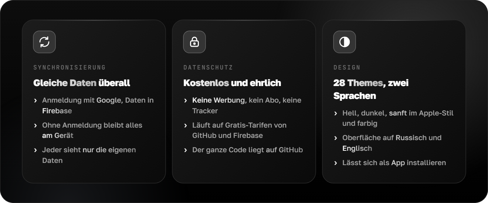
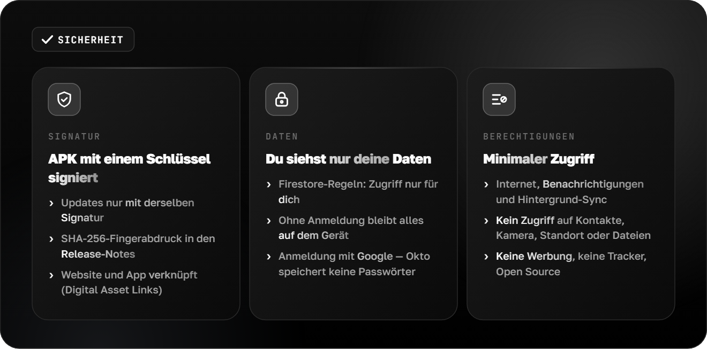

[Русский](README.md) · [English](README.en.md) · [Español](README.es.md) · [Português](README.pt.md) · **Deutsch** · [Français](README.fr.md) · [Italiano](README.it.md) · [Türkçe](README.tr.md) · [Українська](README.uk.md) · [Polski](README.pl.md)

 

<picture><source srcset="assets/readme/hero-de.svg"></picture>

&nbsp;&nbsp;

**Okto läuft auf jedem Gerät** — iPhone und Android, Tablets, Windows, macOS und Linux. Ein Browser genügt, auf Handy und Computer lässt sich Okto als App installieren. Für Android gibt es zusätzlich eine App mit Aufgaben-Widget — auch im [Komi Store](https://github.com/komi-store/komi-store).

> [!NOTE]
> Die App-Oberfläche gibt es auf Russisch und Englisch.

 

 

<picture><source srcset="assets/readme/android-de.svg"></picture>

 

<picture><source srcset="assets/readme/sections-de.svg"></picture>

 

<picture><source srcset="assets/readme/quality-de.svg"></picture>

 

<picture><source srcset="assets/readme/design-de.svg"></picture>

 

<picture><source srcset="assets/readme/more-de.svg"></picture>

Synchronisierung einschalten

Standardmäßig speichert Okto alles im Browser des Geräts. Für dieselben Daten auf Handy und Computer ein kostenloses Firebase-Projekt verbinden (Spark-Tarif, keine Karte nötig):

1. Projekt auf [console.firebase.google.com](https://console.firebase.google.com/) anlegen.
2. **Authentication → Sign-in method** — **Google** aktivieren. Unter **Settings → Authorized domains** `sailxx.github.io` hinzufügen.
3. **Firestore Database** — Datenbank anlegen und [`firestore.rules`](firestore.rules) im Tab **Rules** einfügen.
4. **Project settings → Your apps → Web** — App registrieren und `apiKey`, `authDomain`, `projectId`, `appId` kopieren.
5. Im GitHub-Repo: **Settings → Secrets and variables → Actions** — die Secrets `VITE_FIREBASE_API_KEY`, `VITE_FIREBASE_AUTH_DOMAIN`, `VITE_FIREBASE_PROJECT_ID`, `VITE_FIREBASE_APP_ID` anlegen.
6. Deploy starten. In den Einstellungen von Okto erscheint „Mit Google anmelden“.

Diese Schlüssel sind nicht geheim: Den Zugriff schützen die Firestore-Regeln, jeder sieht nur seine eigenen Daten. Erinnerungen auf der Website kommen, solange der Tab offen ist. In der Android-App kommen Erinnerungen auch bei geschlossenem Okto.

 

<picture><source srcset="assets/readme/safe-de.svg"></picture>

 

## 🗂 Versionen

**3.0** — Bereich „Notizen“ mit Fotos und Dateien; neue Startseite mit weichen, farbigen Karten und Tabs Heute / Woche / Gesamt; schwebende Navigationsleisten und einklappbare Seitenleiste am Desktop; Einstellungen mit einklappbaren Bereichen; überarbeiteter Fokus; Widget-Korrekturen unter Android.

**2.2–2.8** — App-Symbol wählbar; Fotos und Dateien in Aufgaben, Offline-Start; einklappbarer Monat im Kalender; Aufgaben-Erinnerungen unter Android; Aufgaben im Google Kalender; 14 neue helle und dunkle Themes; Textgröße und drei neue Widgets; Aktivitätskarte auf der Startseite.

**2.1** — Android-App mit Aufgaben-Widget für den Startbildschirm; sanfte helle und dunkle Themes im Apple-Stil; Anrufe und Fokus ausblendbar; Sprache in den Einstellungen; Start unter Android behoben.

**2.0** — Aufgaben mit Listen, Wiederholungen, Unteraufgaben und Erinnerungen; Kalender im Stil von Apple Kalender mit Drag & Drop; anpassbarer Start; Synchronisierung über Firebase; Fokus auf eine Aufgabe.

**1.0** — Pomodoro mit vier Modi, farbige Vorlagen-Tags, sieben Designs, Englisch, Browser-Benachrichtigungen.

## ⚖️ Lizenzen

Die Schrift [Inter](https://rsms.me/inter/) steht unter der SIL Open Font License 1.1. Die README-Bilder sind in [JetBrains Mono](https://github.com/JetBrains/JetBrainsMono) (OFL 1.1) + [Golos Text](https://github.com/googlefonts/golos-text) (OFL 1.1) gesetzt.
