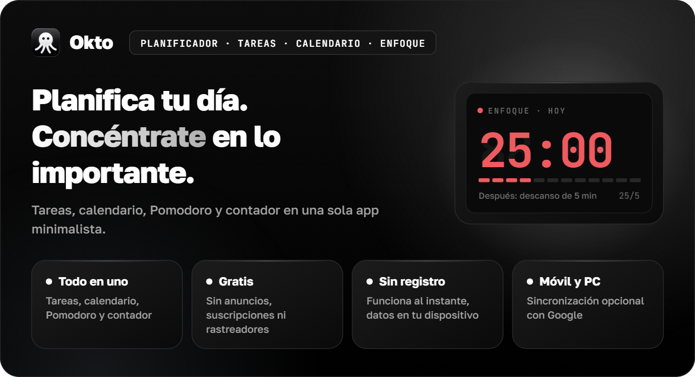
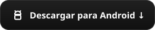
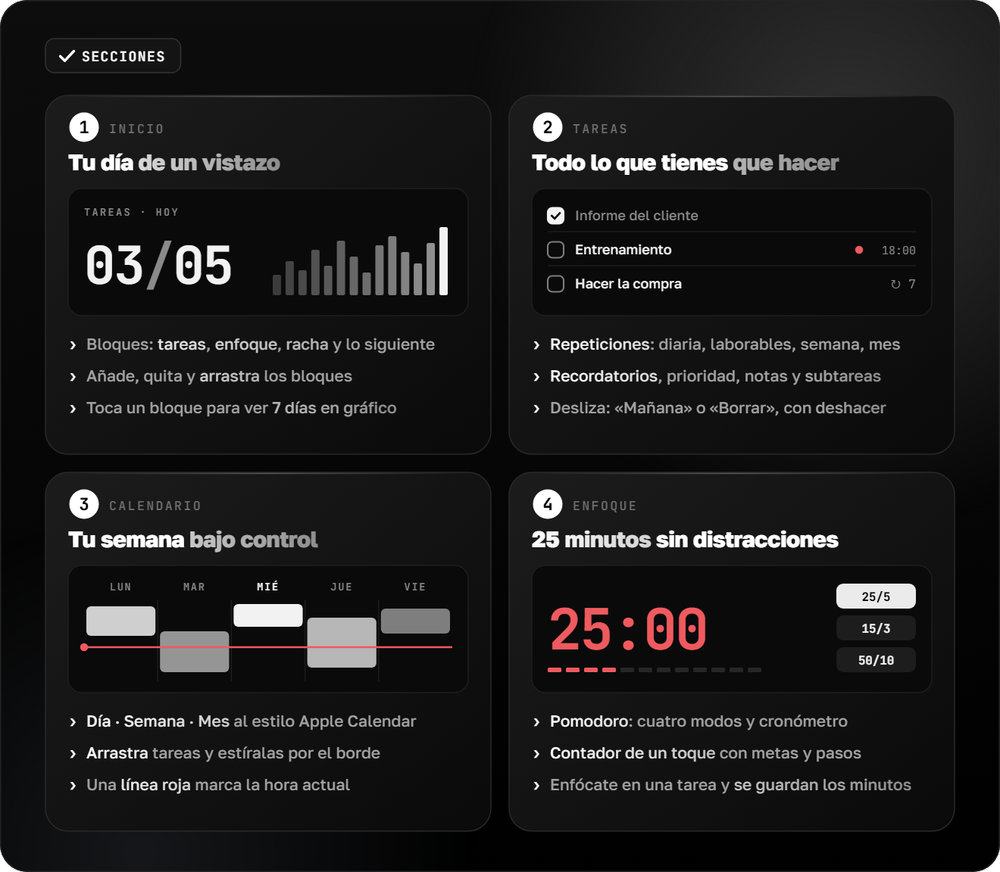
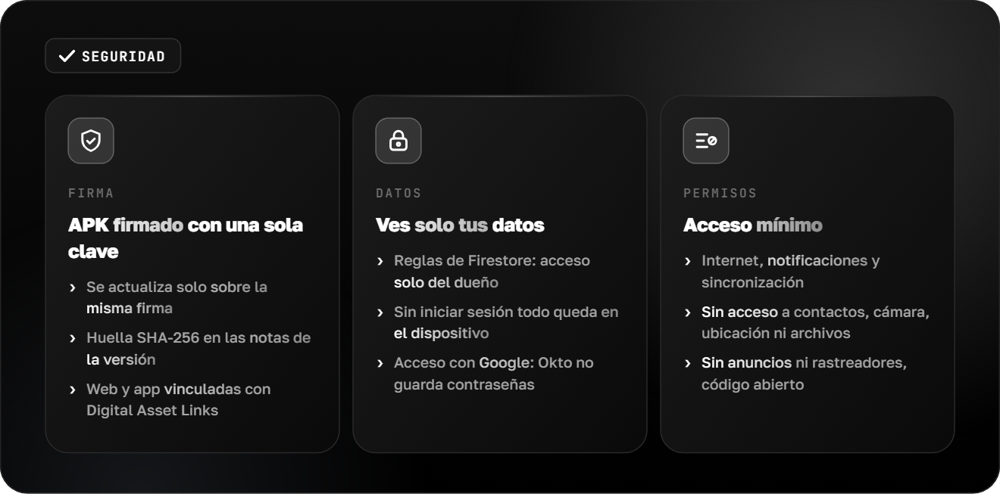

[Русский](README.ru.md) · [English](README.md) · **Español** · [Português](README.pt.md) · [Deutsch](README.de.md) · [Français](README.fr.md) · [Italiano](README.it.md) · [Türkçe](README.tr.md) · [Українська](README.uk.md) · [Polski](README.pl.md)

 

<picture><source srcset="assets/readme/hero-es.svg"></picture>

&nbsp;&nbsp;&nbsp;&nbsp;

**Okto funciona en cualquier dispositivo**: iPhone y Android, tabletas, Windows, macOS y Linux. Solo necesitas un navegador, y en el móvil o el ordenador Okto se instala como app. Para Android hay además una app con widget de tareas, también en [Komi Store](https://github.com/komi-store/komi-store).

> [!NOTE]
> La interfaz de la app está en ruso e inglés.

 

 

<picture><source srcset="assets/readme/sections-es.svg"></picture>

 

Cómo activar la sincronización

Por defecto Okto guarda todo en el navegador del dispositivo. Para tener los mismos datos en el móvil y el ordenador, conecta un proyecto gratuito de Firebase (plan Spark, sin tarjeta):

1. Crea un proyecto en [console.firebase.google.com](https://console.firebase.google.com/).
2. **Authentication → Sign-in method** — activa **Google**. En **Settings → Authorized domains** añade `sailxx.github.io`.
3. **Firestore Database** — crea la base de datos y pega [`firestore.rules`](firestore.rules) en la pestaña **Rules**.
4. **Project settings → Your apps → Web** — registra la app y copia `apiKey`, `authDomain`, `projectId`, `appId`.
5. En el repositorio de GitHub: **Settings → Secrets and variables → Actions** — añade los secretos `VITE_FIREBASE_API_KEY`, `VITE_FIREBASE_AUTH_DOMAIN`, `VITE_FIREBASE_PROJECT_ID`, `VITE_FIREBASE_APP_ID`.
6. Lanza el despliegue. En los ajustes de Okto aparecerá «Entrar con Google».

Estas claves no son secretas: el acceso lo protegen las reglas de Firestore y cada uno ve solo sus datos. Los recordatorios en la web funcionan mientras la pestaña está abierta. En la app de Android, los recordatorios llegan aunque Okto esté cerrado.

 

<picture><source srcset="assets/readme/safe-es.svg"></picture>

 

## 🗂 Historial de versiones

**3.0** — sección Notas con fotos y archivos; nuevo Inicio con tarjetas suaves de colores y pestañas Hoy / Semana / Totales; barras de navegación flotantes y barra lateral plegable en escritorio; ajustes con secciones plegables; Foco renovado; correcciones de widgets en Android.

**2.2–2.8** — icono a elegir; fotos y archivos en las tareas, inicio sin conexión; mes plegable en el calendario; recordatorios de tareas en Android; tareas en Google Calendar; 14 temas nuevos claros y oscuros; tamaño de texto y tres widgets nuevos; mapa de actividad en el inicio.

**2.1** — app de Android con widget de tareas en la pantalla de inicio; temas claro y oscuro suaves al estilo Apple; Llamadas y Enfoque se pueden ocultar; el idioma se elige en Ajustes; arreglado el inicio en Android.

**2.0** — tareas con listas, repeticiones, subtareas y recordatorios; calendario al estilo Apple Calendar con arrastrar y soltar; inicio personalizable; sincronización con Firebase; enfoque en una tarea.

**1.0** — Pomodoro con cuatro modos, etiquetas con colores, siete temas, idioma inglés, notificaciones del navegador.

## ⚖️ Licencias

La fuente [Inter](https://rsms.me/inter/) usa la licencia SIL Open Font License 1.1. Las imágenes del README usan [JetBrains Mono](https://github.com/JetBrains/JetBrainsMono) (OFL 1.1) + [Golos Text](https://github.com/googlefonts/golos-text) (OFL 1.1).
