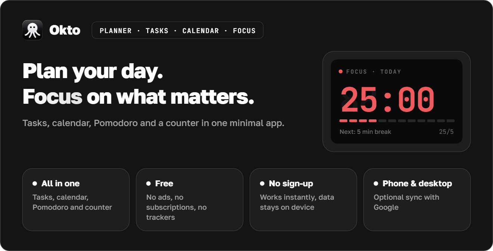

[English](README.md) · [العربية](README.ar.md) · [简体中文](README.zh-CN.md) · [繁體中文](README.zh-TW.md) · [Čeština](README.cs.md) · [Français](README.fr.md) · [Deutsch](README.de.md) · [Ελληνικά](README.el.md) · **Bahasa Indonesia** · [Gaeilge](README.ga.md) · [Italiano](README.it.md) · [日本語](README.ja.md) · [한국어](README.ko.md) · [Polski](README.pl.md) · [Română](README.ro.md) · [Русский](README.ru.md) · [Español](README.es.md) · [Українська](README.uk.md) · [اردو](README.ur.md) · [ئۇيغۇرچە](README.ug.md) · [Tiếng Việt](README.vi.md) · [Português](README.pt.md) · [Türkçe](README.tr.md)

 

<picture><source srcset="assets/readme/hero-en.svg"></picture>

&nbsp; & nbsp;&nbsp; & nbsp;

**Okto berfungsi di perangkat apa pun** — iPhone dan Android, tablet, Windows, macOS dan Linux. Yang Anda butuhkan hanyalah browser, dan Okto diinstal sebagai aplikasi di ponsel atau komputer Anda. Android juga mendapat aplikasi khusus dengan widget tugas — Anda dapat menemukannya di [Toko Komi](https://github.com/komi-store/komi-store) juga.

> [!NOTE]
> Antarmuka aplikasi tersedia dalam bahasa Rusia dan Inggris.

Android APK membuka perencana secara offline, termasuk pada peluncuran pertama. Masuk dengan akun Google yang sama untuk memulihkan data yang disinkronkan dan pengaturan tampilan. Data dan lampiran yang hanya disimpan di aplikasi browser lama tetap tersedia di sana.

 

 

<picture><source srcset="assets/readme/sections-en.svg"></picture>

 

Cara mengaktifkan sinkronisasi

Okto siap pakai menyimpan semua yang ada di browser di perangkat Anda. Untuk mendapatkan data yang sama di ponsel dan komputer, sambungkan proyek Firebase gratis (Paket Spark, tidak perlu kartu):

1. Buat proyek di [konsol.firebase.google.com](https://console.firebase.google.com/).
2. **Otentikasi → Metode masuk** — memungkinkan **Google**. Di dalam **Pengaturan → Domain resmi** menambahkan `sailxx-apps.github.io`.
3. **Basis Data Firestore** — buat database dan tempel [`firestore.rules`](firestore.rules) ke dalam **Aturan** tab.
4. **Pengaturan proyek → Aplikasi Anda → Web** — daftarkan aplikasi dan salin `apiKey`, `authDomain`, `projectId`, `appId`.
5. Di repo GitHub: **Pengaturan → Rahasia dan variabel → Tindakan** — tambahkan rahasianya `VITE_FIREBASE_API_KEY`, `VITE_FIREBASE_AUTH_DOMAIN`, `VITE_FIREBASE_PROJECT_ID`, `VITE_FIREBASE_APP_ID`.
6. Jalankan penerapan. “Masuk dengan Google” muncul di pengaturan Okto.

Kunci ini tidak bersifat rahasia — akses dilindungi oleh aturan Firestore, sehingga setiap orang hanya melihat datanya sendiri. Pengingat di situs web aktif saat tab terbuka. Di aplikasi Android, pengingat tetap muncul bahkan saat Okto ditutup.

 

<picture><source srcset="assets/readme/safe-en.svg"></picture>

 

## Tentang Okto

<picture><source srcset="assets/readme/about-en.svg"></picture>

Okto dimulai pada 2 Oktober 2026 sebagai penghitung web sederhana. Itu berkembang menjadi perencana gratis untuk tugas, kalender, dan fokus. Tidak ada iklan, analitik, atau pelacak. Entri Anda tetap ada di perangkat Anda, dan Anda dapat ikut serta dalam sinkronisasi melalui Google Firebase. [Keamanan: tanda tangan, data, izin](PRIVACY.md)

## Peta jalan

<picture><source srcset="assets/readme/roadmap-en.svg"></picture>

**2026-10-02** — Okto pertama adalah penghitung satu ketukan dengan target dan stopwatch.

**1.0** — Pomodoro dengan empat mode, tag preset berwarna, tujuh tema, bahasa Inggris, notifikasi browser.

**2.0** — tugas dengan daftar, pengulangan, subtugas dan pengingat; Kalender gaya Kalender Apple dengan drag dan drop; layar beranda yang dapat disesuaikan; Sinkronisasi Firebase; fokus pada suatu tugas.

**2.1** — Aplikasi Android dengan widget tugas layar beranda; tema terang lembut dan gelap dalam gaya Apple; Panggilan dan Fokus dapat disembunyikan; bahasa diatur di Pengaturan; peluncuran tetap pada Android.

**2.2–2.8** — pilih ikon aplikasi; foto dan file dalam tugas, peluncuran offline; bulan yang dapat dilipat di kalender; pengingat tugas di Android; tugas di Google Kalender; 14 tema terang dan gelap baru; ukuran teks dan tiga widget baru; peta aktivitas di layar beranda.

**3.0** — bagian Catatan dengan foto dan file; Beranda baru dengan kartu berwarna lembut dan tab Hari Ini / Minggu / Total; bilah navigasi mengambang dan bilah sisi yang dapat dilipat di desktop; Pengaturan dengan bagian yang dapat dilipat; layar Fokus yang diperbarui; Perbaikan widget Android.

[**3.23.6**](https://github.com/sailxx/Okto/releases/tag/v3.23.6) — Okto memperoleh aplikasi baki Windows. Perencana Android terbuka secara offline, dan 3.23.6 meningkatkan lampiran dan layar Fokus.

## ⚖️ Lisensi

Itu [Antar](https://rsms.me/inter/) font dilisensikan di bawah Lisensi Font Terbuka SIL 1.1. Gambar README sudah diatur [JetBrains Mono](https://github.com/JetBrains/JetBrainsMono) (OFL 1.1) + [Golos Text](https://github.com/googlefonts/golos-text) (OFL 1.1).
