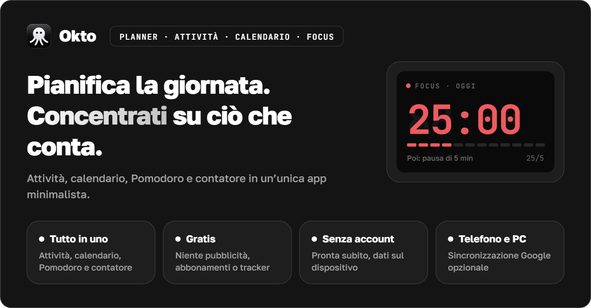
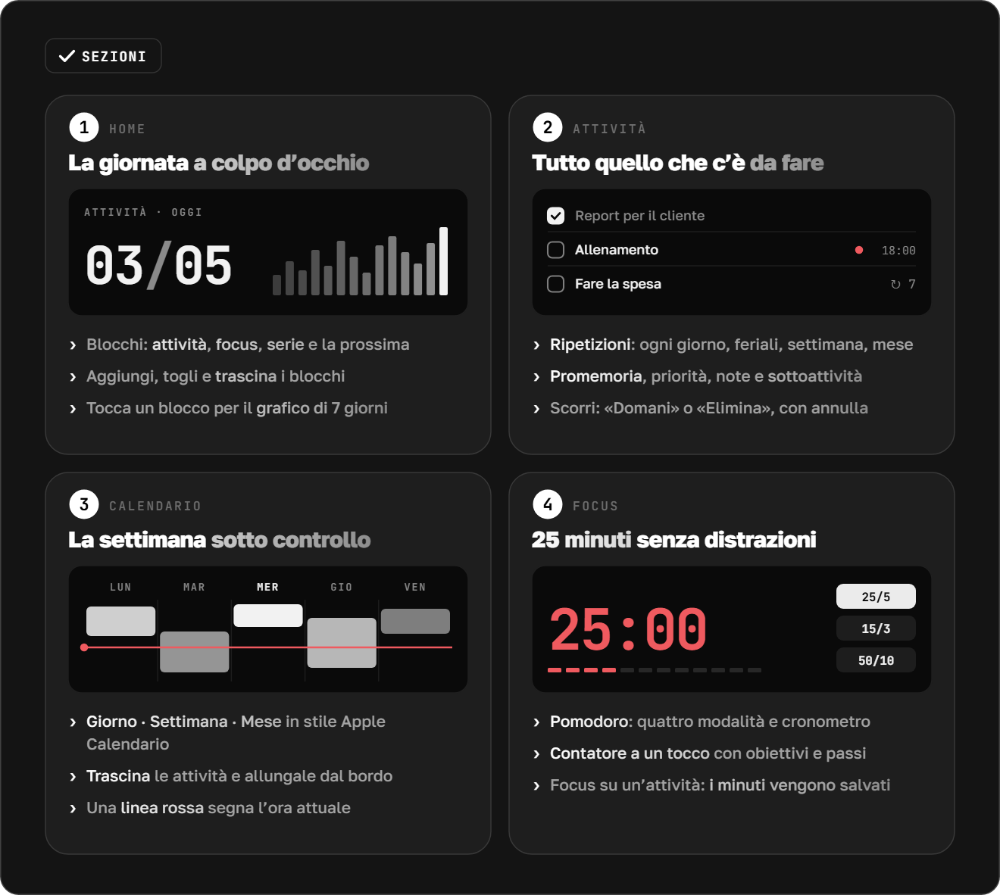
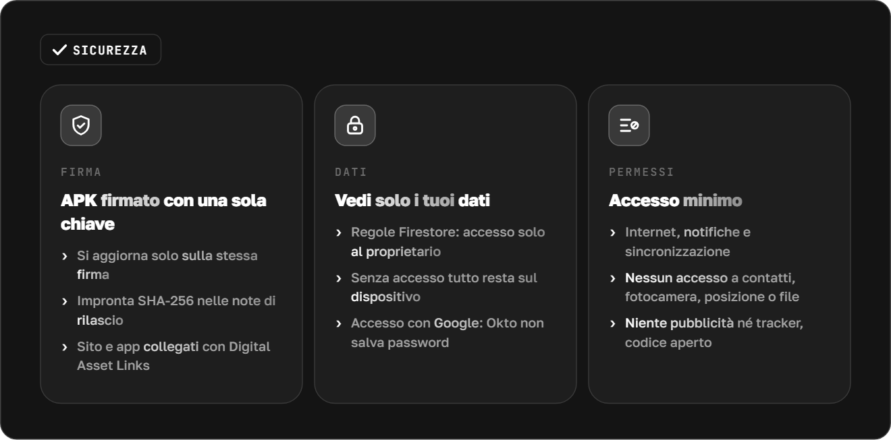

[English](README.md) · [العربية](README.ar.md) · [简体中文](README.zh-CN.md) · [繁體中文](README.zh-TW.md) · [Čeština](README.cs.md) · [Français](README.fr.md) · [Deutsch](README.de.md) · [Ελληνικά](README.el.md) · [Bahasa Indonesia](README.id.md) · [Gaeilge](README.ga.md) · **Italiano** · [日本語](README.ja.md) · [한국어](README.ko.md) · [Polski](README.pl.md) · [Română](README.ro.md) · [Русский](README.ru.md) · [Español](README.es.md) · [Українська](README.uk.md) · [اردو](README.ur.md) · [ئۇيغۇرچە](README.ug.md) · [Tiếng Việt](README.vi.md) · [Português](README.pt.md) · [Türkçe](README.tr.md)

 

<picture><source srcset="assets/readme/hero-it.svg"></picture>

&nbsp;&nbsp;&nbsp;&nbsp;

**Okto funziona su qualsiasi dispositivo**: iPhone e Android, tablet, Windows, macOS e Linux. Basta un browser, e su telefono o computer Okto si installa come app. Per Android c'è anche un'app con widget delle attività, disponibile anche su [Komi Store](https://github.com/komi-store/komi-store).

> [!NOTE]
> L’interfaccia dell’app è in russo e inglese.

 

 

<picture><source srcset="assets/readme/sections-it.svg"></picture>

 

Come attivare la sincronizzazione

Di base Okto salva tutto nel browser del dispositivo. Per avere gli stessi dati su telefono e computer, collega un progetto Firebase gratuito (piano Spark, senza carta):

1. Crea un progetto su [console.firebase.google.com](https://console.firebase.google.com/).
2. **Authentication → Sign-in method** — attiva **Google**. In **Settings → Authorized domains** aggiungi `sailxx-apps.github.io`.
3. **Firestore Database** — crea il database e incolla [`firestore.rules`](firestore.rules) nella scheda **Rules**.
4. **Project settings → Your apps → Web** — registra l’app e copia `apiKey`, `authDomain`, `projectId`, `appId`.
5. Nel repository GitHub: **Settings → Secrets and variables → Actions** — aggiungi i secret `VITE_FIREBASE_API_KEY`, `VITE_FIREBASE_AUTH_DOMAIN`, `VITE_FIREBASE_PROJECT_ID`, `VITE_FIREBASE_APP_ID`.
6. Avvia il deploy. Nelle impostazioni di Okto comparirà «Accedi con Google».

Queste chiavi non sono segrete: l’accesso è protetto dalle regole di Firestore e ognuno vede solo i propri dati. I promemoria sul sito funzionano finché la scheda è aperta. Nell’app Android i promemoria arrivano anche con Okto chiuso.

 

<picture><source srcset="assets/readme/safe-it.svg"></picture>

 

## Informazioni su Okto

<picture><source srcset="assets/readme/about-it.svg"></picture>

Okto è nato il 2 ottobre 2026 come semplice contatore web. Oggi è un pianificatore gratuito per attività, calendario e concentrazione. Non ci sono pubblicità, analisi o tracker. I dati restano sul dispositivo e la sincronizzazione con Google Firebase è facoltativa. [Sicurezza: firma, dati, permessi](PRIVACY.md)

## Tabella di marcia

<picture><source srcset="assets/readme/roadmap-it.svg"></picture>

**2026-10-02** — Il primo Okto era un contatore a un tocco con obiettivo e cronometro.

**1.0** — Pomodoro con quattro modalità, tag colorati, sette temi, inglese, notifiche del browser.

**2.0** — attività con liste, ripetizioni, sottoattività e promemoria; calendario in stile Apple Calendario con trascinamento; home personalizzabile; sincronizzazione con Firebase; focus su un’attività.

**2.1** — app Android con widget delle attività nella schermata Home; temi chiaro e scuro morbidi in stile Apple; Chiamate e Focus nascondibili; lingua nelle Impostazioni; corretto l'avvio su Android.

**2.2–2.8** — icona a scelta; foto e file nelle attività, avvio offline; mese comprimibile nel calendario; promemoria delle attività su Android; attività in Google Calendar; 14 nuovi temi chiari e scuri; dimensione del testo e tre nuovi widget; mappa delle attività nella Home.

**3.0** — sezione Note con foto e file; nuova Home con schede morbide e colorate e schede Oggi / Settimana / Totali; barre di navigazione flottanti e barra laterale comprimibile su desktop; impostazioni con sezioni comprimibili; Focus rinnovato; correzioni ai widget Android.

[**3.23.6**](https://github.com/sailxx/Okto/releases/tag/v3.23.6) — Okto è arrivato nell’area di notifica di Windows. Il pianificatore Android si apre offline e la versione 3.23.6 migliora gli allegati e la schermata di concentrazione.

## ⚖️ Licenze

Il font [Inter](https://rsms.me/inter/) è distribuito con la SIL Open Font License 1.1. Le immagini del README usano [JetBrains Mono](https://github.com/JetBrains/JetBrainsMono) (OFL 1.1) + [Golos Text](https://github.com/googlefonts/golos-text) (OFL 1.1).
