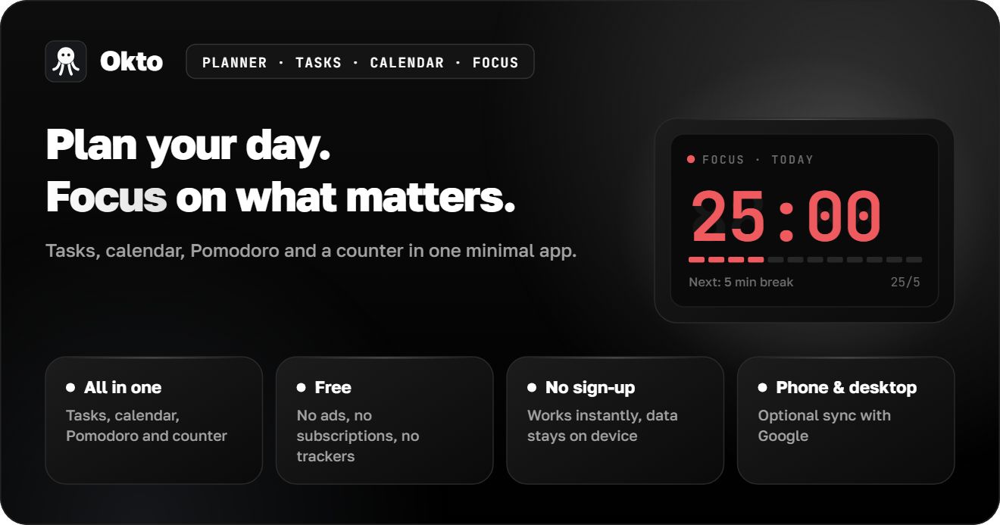
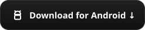
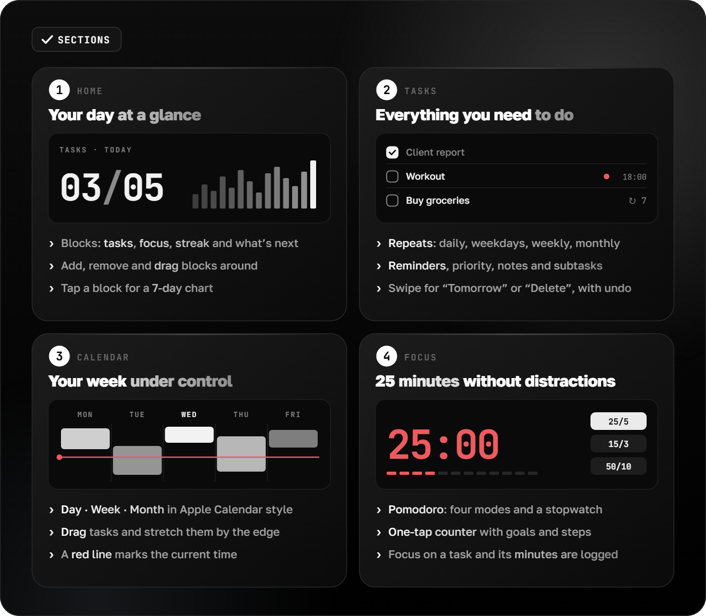
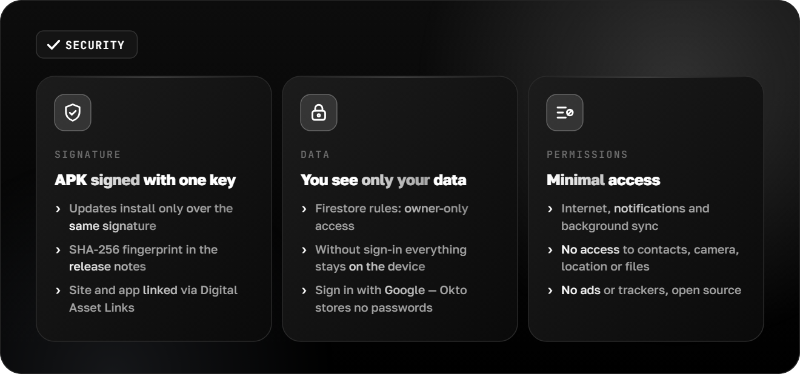

[Русский](README.ru.md) · **English** · [Español](README.es.md) · [Português](README.pt.md) · [Deutsch](README.de.md) · [Français](README.fr.md) · [Italiano](README.it.md) · [Türkçe](README.tr.md) · [Українська](README.uk.md) · [Polski](README.pl.md)

 

<picture><source srcset="assets/readme/hero-en.svg"></picture>

&nbsp;&nbsp;&nbsp;&nbsp;

**Okto works on any device** — iPhone and Android, tablets, Windows, macOS and Linux. All you need is a browser, and Okto installs as an app on your phone or computer. Android also gets a dedicated app with a task widget — you can find it in [Komi Store](https://github.com/komi-store/komi-store) too.

> [!NOTE]
> The app interface is available in Russian and English.

 

 

<picture><source srcset="assets/readme/sections-en.svg"></picture>

 

How to turn on sync

Out of the box Okto keeps everything in the browser on your device. To have the same data on phone and computer, connect a free Firebase project (Spark plan, no card needed):

1. Create a project at [console.firebase.google.com](https://console.firebase.google.com/).
2. **Authentication → Sign-in method** — enable **Google**. In **Settings → Authorized domains** add `sailxx.github.io`.
3. **Firestore Database** — create a database and paste [`firestore.rules`](firestore.rules) into the **Rules** tab.
4. **Project settings → Your apps → Web** — register the app and copy `apiKey`, `authDomain`, `projectId`, `appId`.
5. In the GitHub repo: **Settings → Secrets and variables → Actions** — add the secrets `VITE_FIREBASE_API_KEY`, `VITE_FIREBASE_AUTH_DOMAIN`, `VITE_FIREBASE_PROJECT_ID`, `VITE_FIREBASE_APP_ID`.
6. Run the deploy. “Sign in with Google” appears in Okto’s settings.

These keys are not secret — access is protected by Firestore rules, so everyone sees only their own data. Reminders on the website fire while the tab is open. In the Android app, reminders arrive even when Okto is closed.

 

<picture><source srcset="assets/readme/safe-en.svg"></picture>

 

## 🗂 Version history

**3.0** — a Notes section with photos and files; a new Home with soft coloured cards and Today / Week / Totals tabs; floating navigation bars and a collapsible sidebar on desktop; Settings with collapsible sections; a refreshed Focus screen; Android widget fixes.

**2.2–2.8** — choose the app icon; photos and files in tasks, offline launch; collapsible month in the calendar; task reminders on Android; tasks in Google Calendar; 14 new light and dark themes; text size and three new widgets; activity map on the home screen.

**2.1** — Android app with a home-screen task widget; soft light and dark themes in Apple style; Calls and Focus can be hidden; language is set in Settings; fixed launching on Android.

**2.0** — tasks with lists, repeats, subtasks and reminders; Apple Calendar style calendar with drag and drop; a customisable home screen; Firebase sync; focus on a task.

**1.0** — Pomodoro with four modes, coloured preset tags, seven themes, English language, browser notifications.

## ⚖️ Licenses

The [Inter](https://rsms.me/inter/) font is licensed under the SIL Open Font License 1.1. README images are set in [JetBrains Mono](https://github.com/JetBrains/JetBrainsMono) (OFL 1.1) + [Golos Text](https://github.com/googlefonts/golos-text) (OFL 1.1).
