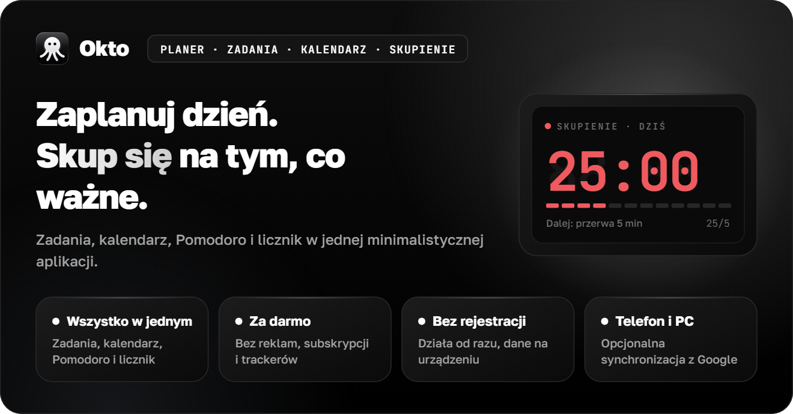
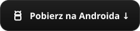
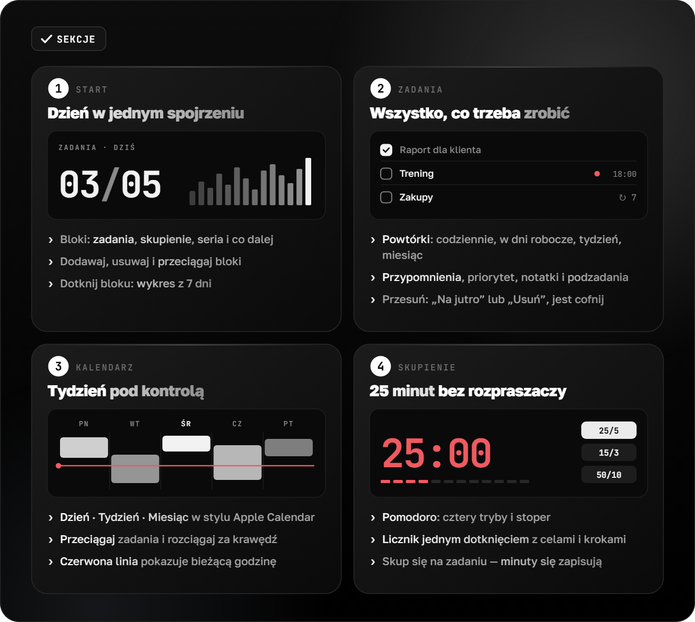
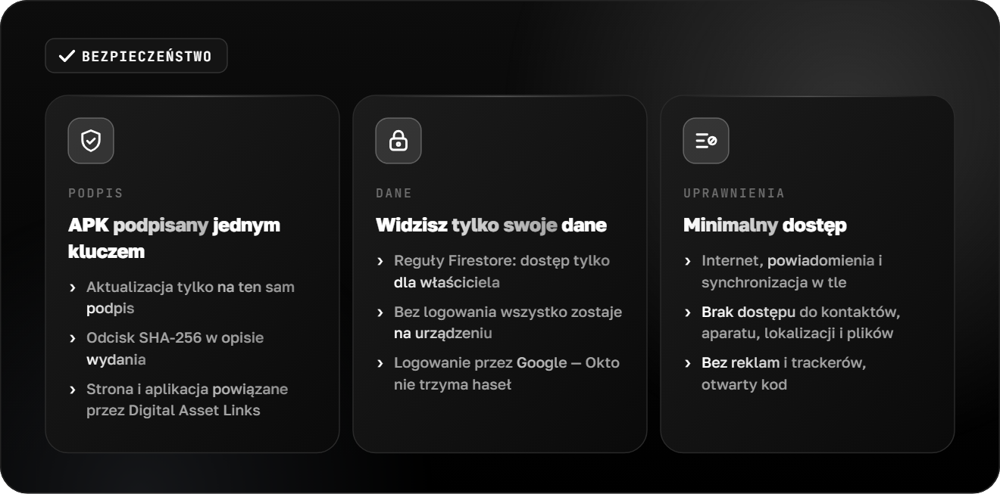

[Русский](README.ru.md) · [English](README.md) · [Español](README.es.md) · [Português](README.pt.md) · [Deutsch](README.de.md) · [Français](README.fr.md) · [Italiano](README.it.md) · [Türkçe](README.tr.md) · [Українська](README.uk.md) · **Polski**

 

<picture><source srcset="assets/readme/hero-pl.svg"></picture>

&nbsp;&nbsp;&nbsp;&nbsp;

**Okto działa na każdym urządzeniu** — iPhone i Android, tablet, Windows, macOS i Linux. Wystarczy przeglądarka, a na telefonie i komputerze Okto instaluje się jak aplikacja. Na Androida jest też osobna aplikacja z widżetem zadań — znajdziesz ją także w [Komi Store](https://github.com/komi-store/komi-store).

> [!NOTE]
> Interfejs aplikacji jest po rosyjsku i angielsku.

 

 

<picture><source srcset="assets/readme/sections-pl.svg"></picture>

 

Jak włączyć synchronizację

Domyślnie Okto trzyma wszystko w przeglądarce na urządzeniu. Aby mieć te same dane na telefonie i komputerze, podłącz darmowy projekt Firebase (plan Spark, bez karty):

1. Utwórz projekt na [console.firebase.google.com](https://console.firebase.google.com/).
2. **Authentication → Sign-in method** — włącz **Google**. W **Settings → Authorized domains** dodaj `sailxx.github.io`.
3. **Firestore Database** — utwórz bazę i wklej [`firestore.rules`](firestore.rules) w zakładce **Rules**.
4. **Project settings → Your apps → Web** — zarejestruj aplikację i skopiuj `apiKey`, `authDomain`, `projectId`, `appId`.
5. W repozytorium na GitHubie: **Settings → Secrets and variables → Actions** — dodaj sekrety `VITE_FIREBASE_API_KEY`, `VITE_FIREBASE_AUTH_DOMAIN`, `VITE_FIREBASE_PROJECT_ID`, `VITE_FIREBASE_APP_ID`.
6. Uruchom wdrożenie. W ustawieniach Okto pojawi się „Zaloguj przez Google”.

Te klucze nie są tajne — dostęp chronią reguły Firestore, każdy widzi tylko swoje dane. Przypomnienia na stronie działają, dopóki karta jest otwarta. W aplikacji na Androida przypomnienia przychodzą, nawet gdy Okto jest zamknięte.

 

<picture><source srcset="assets/readme/safe-pl.svg"></picture>

 

## 🗂 Historia wersji

**3.0** — sekcja Notatki ze zdjęciami i plikami; nowy ekran główny z miękkimi kolorowymi kartami i zakładkami Dziś / Tydzień / Podsumowanie; pływające paski nawigacji i zwijany panel boczny na komputerze; ustawienia ze zwijanymi sekcjami; odświeżony Fokus; poprawki widgetów na Androidzie.

**2.2–2.8** — ikona do wyboru; zdjęcia i pliki w zadaniach, uruchamianie offline; zwijany miesiąc w kalendarzu; przypomnienia o zadaniach na Androidzie; zadania w Kalendarzu Google; 14 nowych jasnych i ciemnych motywów; rozmiar tekstu i trzy nowe widżety; mapa aktywności na stronie głównej.

**2.1** — aplikacja na Androida z widżetem zadań na ekranie głównym; łagodne jasny i ciemny motyw w stylu Apple; Rozmowy i Fokus można ukryć; język w Ustawieniach; naprawione uruchamianie na Androidzie.

**2.0** — zadania z listami, powtórkami, podzadaniami i przypomnieniami; kalendarz w stylu Apple Calendar z przeciąganiem; konfigurowalny ekran startowy; synchronizacja przez Firebase; skupienie na zadaniu.

**1.0** — Pomodoro z czterema trybami, kolorowe gotowe tagi, siedem motywów, język angielski, powiadomienia w przeglądarce.

## ⚖️ Licencje

Czcionka [Inter](https://rsms.me/inter/) jest na licencji SIL Open Font License 1.1. Obrazy w README używają [JetBrains Mono](https://github.com/JetBrains/JetBrainsMono) (OFL 1.1) + [Golos Text](https://github.com/googlefonts/golos-text) (OFL 1.1).
