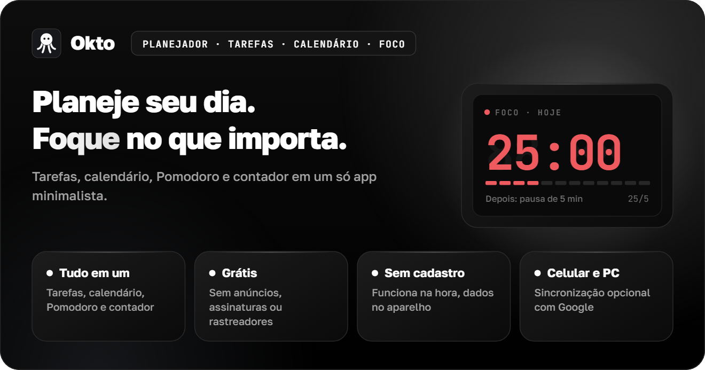
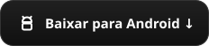
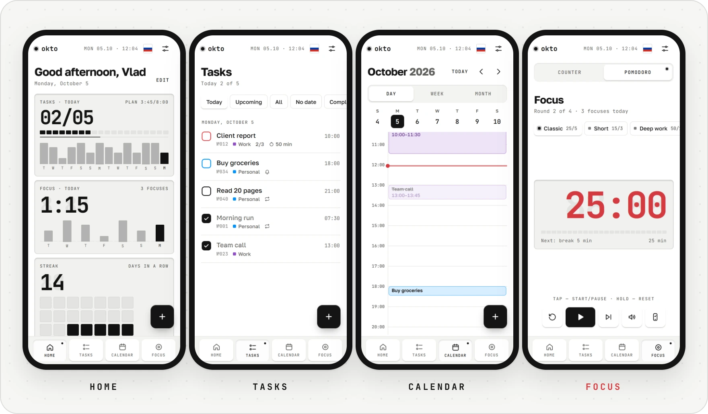
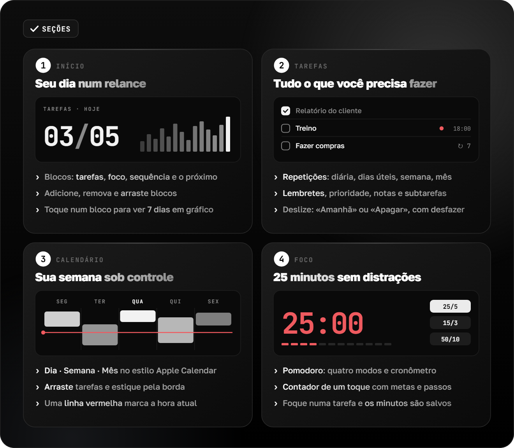
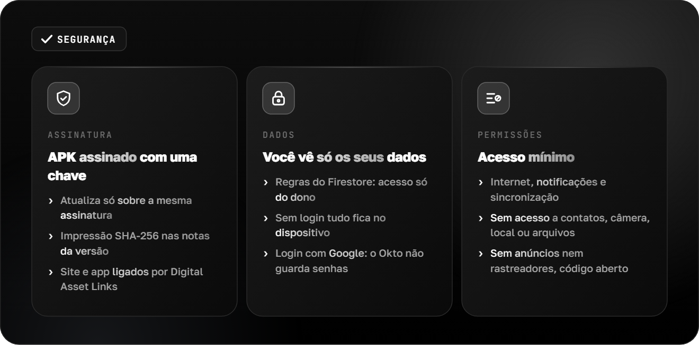

[Русский](README.md) · [English](README.en.md) · [Español](README.es.md) · **Português** · [Deutsch](README.de.md) · [Français](README.fr.md) · [Italiano](README.it.md) · [Türkçe](README.tr.md) · [Українська](README.uk.md) · [Polski](README.pl.md)

 

<picture><source srcset="assets/readme/hero-pt.svg"></picture>

&nbsp;&nbsp;

**O Okto funciona em qualquer dispositivo**: iPhone e Android, tablets, Windows, macOS e Linux. Basta um navegador, e no celular ou no computador o Okto se instala como app. Para Android há também um app com widget de tarefas, disponível também na [Komi Store](https://github.com/komi-store/komi-store).

> [!NOTE]
> A interface do app está em russo e inglês.

 

 

<picture><source srcset="assets/readme/sections-pt.svg"></picture>

 

Como ativar a sincronização

Por padrão o Okto guarda tudo no navegador do aparelho. Para ter os mesmos dados no celular e no computador, conecte um projeto gratuito do Firebase (plano Spark, sem cartão):

1. Crie um projeto em [console.firebase.google.com](https://console.firebase.google.com/).
2. **Authentication → Sign-in method** — ative o **Google**. Em **Settings → Authorized domains** adicione `sailxx.github.io`.
3. **Firestore Database** — crie o banco e cole [`firestore.rules`](firestore.rules) na aba **Rules**.
4. **Project settings → Your apps → Web** — registre o app e copie `apiKey`, `authDomain`, `projectId`, `appId`.
5. No repositório do GitHub: **Settings → Secrets and variables → Actions** — adicione os secrets `VITE_FIREBASE_API_KEY`, `VITE_FIREBASE_AUTH_DOMAIN`, `VITE_FIREBASE_PROJECT_ID`, `VITE_FIREBASE_APP_ID`.
6. Rode o deploy. Nas configurações do Okto aparecerá «Entrar com Google».

Essas chaves não são secretas: o acesso é protegido pelas regras do Firestore e cada um vê só os próprios dados. Os lembretes no site funcionam enquanto a aba está aberta. No app para Android, os lembretes chegam mesmo com o Okto fechado.

 

<picture><source srcset="assets/readme/safe-pt.svg"></picture>

 

## 🗂 Histórico de versões

**3.0** — seção Notas com fotos e arquivos; novo Início com cartões suaves e coloridos e abas Hoje / Semana / Totais; barras de navegação flutuantes e barra lateral recolhível no computador; configurações com seções recolhíveis; Foco renovado; correções dos widgets no Android.

**2.2–2.8** — ícone à escolha; fotos e arquivos nas tarefas, abertura offline; mês recolhível no calendário; lembretes de tarefas no Android; tarefas no Google Agenda; 14 temas novos claros e escuros; tamanho do texto e três widgets novos; mapa de atividade no início.

**2.1** — app Android com widget de tarefas na tela inicial; temas claro e escuro suaves no estilo Apple; Chamadas e Foco podem ser ocultados; o idioma fica nas Configurações; corrigida a abertura no Android.

**2.0** — tarefas com listas, repetições, subtarefas e lembretes; calendário no estilo Apple Calendar com arrastar e soltar; início personalizável; sincronização com Firebase; foco numa tarefa.

**1.0** — Pomodoro com quatro modos, etiquetas coloridas, sete temas, idioma inglês, notificações do navegador.

## ⚖️ Licenças

A fonte [Inter](https://rsms.me/inter/) usa a licença SIL Open Font License 1.1. As imagens do README usam [JetBrains Mono](https://github.com/JetBrains/JetBrainsMono) (OFL 1.1) + [Golos Text](https://github.com/googlefonts/golos-text) (OFL 1.1).
