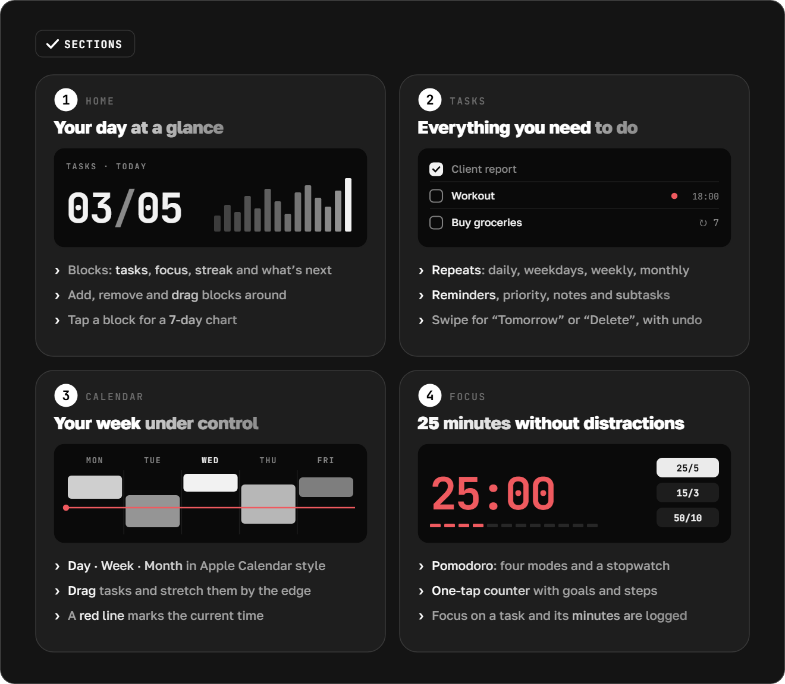

[English](README.md) · [العربية](README.ar.md) · [简体中文](README.zh-CN.md) · [繁體中文](README.zh-TW.md) · [Čeština](README.cs.md) · [Français](README.fr.md) · [Deutsch](README.de.md) · [Ελληνικά](README.el.md) · [Bahasa Indonesia](README.id.md) · [Gaeilge](README.ga.md) · [Italiano](README.it.md) · [日本語](README.ja.md) · [한국어](README.ko.md) · [Polski](README.pl.md) · **Română** · [Русский](README.ru.md) · [Español](README.es.md) · [Українська](README.uk.md) · [اردو](README.ur.md) · [ئۇيغۇرچە](README.ug.md) · [Tiếng Việt](README.vi.md) · [Português](README.pt.md) · [Türkçe](README.tr.md)

 

<picture><source srcset="assets/readme/hero-en.svg"></picture>

&nbsp; &nbsp;&nbsp; &nbsp;

**Okto funcționează pe orice dispozitiv** — iPhone și Android , tablete, Windows , macOS și Linux . Tot ce aveți nevoie este un browser, iar Okto se instalează ca aplicație pe telefon sau computer. Android primește, de asemenea, o aplicație dedicată cu un widget pentru activități - o puteți găsi în [Magazinul Komi](https://github.com/komi-store/komi-store) prea.

> [!NOTE]
> Interfața aplicației este disponibilă în rusă și engleză.

Android APK deschide planificatorul offline, inclusiv la prima lansare. Conectați-vă cu același cont Google pentru a restabili datele sincronizate și setările de aspect. Datele și atașamentele stocate numai în vechea aplicație de browser rămân disponibile acolo.

 

 

<picture><source srcset="assets/readme/sections-en.svg"></picture>

 

Cum să activați sincronizarea

Ieșit din cutie, Okto păstrează totul în browser pe dispozitivul dvs. Pentru a avea aceleași date pe telefon și computer, conectați un proiect Firebase gratuit (plan Spark, nu este nevoie de card):

1. Creați un proiect la [console.firebase.google.com](https://console.firebase.google.com/).
2. **Autentificare → Metodă de conectare** — permite **Google**. În **Setări → Domenii autorizate** adăuga `sailxx-apps.github.io`.
3. **Baza de date Firestore** — creați o bază de date și lipiți [`firestore.rules`](firestore.rules) în **Reguli** fila.
4. **Setări proiect → Aplicațiile dvs. → Web** — înregistrați aplicația și copiați `apiKey`, `authDomain`, `projectId`, `appId`.
5. În depozitul GitHub: **Setări → Secrete și variabile → Acțiuni** — adaugă secretele `VITE_FIREBASE_API_KEY`, `VITE_FIREBASE_AUTH_DOMAIN`, `VITE_FIREBASE_PROJECT_ID`, `VITE_FIREBASE_APP_ID`.
6. Rulați implementarea. „Conectați-vă cu Google” apare în setările lui Okto.

Aceste chei nu sunt secrete - accesul este protejat de regulile Firestore, astfel încât toată lumea vede doar propriile date. Mementourile de pe site se declanșează în timp ce fila este deschisă. În aplicația Android, mementourile ajung chiar și atunci când Okto este închis.

 

<picture><source srcset="assets/readme/safe-en.svg"></picture>

 

## Despre Okto

<picture><source srcset="assets/readme/about-en.svg"></picture>

Okto a început pe 2 octombrie 2026 ca un simplu contor web. A devenit un planificator gratuit pentru sarcini, calendare și concentrare. Nu există reclame, analize sau instrumente de urmărire. Intrările dvs. rămân pe dispozitiv și vă puteți înscrie pentru sincronizare prin Google Firebase. [Securitate: semnătură, date, permisiuni](PRIVACY.md)

## Foaia de parcurs

<picture><source srcset="assets/readme/roadmap-en.svg"></picture>

**2026-10-02** — Primul Okto a fost un contor cu o singură atingere, cu țintă și cronometru.

**1.0** — Pomodoro cu patru moduri, etichete colorate presetate, șapte teme, limba engleză, notificări pentru browser.

**2.0** — sarcini cu liste, repetări, subsarcini și mementouri; Calendar în stil Apple Calendar cu drag and drop; un ecran de pornire personalizabil; Sincronizare Firebase; concentrați-vă pe o sarcină.

**2.1** — Aplicația Android cu un widget de activitate pe ecranul de pornire; teme luminoase și întunecate în stil Apple; Apelurile și Focusul pot fi ascunse; limba este setată în Setări; Lansare fixă ​​pe Android.

**2.2–2.8** — alegeți pictograma aplicației; fotografii și fișiere în sarcini, lansare offline; lună pliabilă în calendar; mementouri de sarcină pe Android; sarcini în Google Calendar; 14 teme noi de lumină și întuneric; dimensiunea textului și trei widget-uri noi; harta de activitate pe ecranul de start.

**3.0** — o secțiune Note cu fotografii și fișiere; o Acasă nouă cu cărți colorate și filele Azi / Săptămâna / Totaluri; bare de navigare plutitoare și o bară laterală pliabilă pe desktop; Setări cu secțiuni pliabile; un ecran Focus reîmprospătat; Remedieri widget Android.

[**3.23.6**](https://github.com/sailxx/Okto/releases/tag/v3.23.6) — Okto a câștigat o aplicație pentru tavă Windows. Planificatorul Android se deschide offline, iar 3.23.6 îmbunătățește atașamentele și ecranul Focus.

## ⚖️ Licențe

The [Inter](https://rsms.me/inter/) fontul este licențiat conform Licenței pentru font deschis SIL 1.1. Imaginile README sunt setate [JetBrains Mono](https://github.com/JetBrains/JetBrainsMono) (OFL 1.1) + [Golos Text](https://github.com/googlefonts/golos-text) (OFL 1.1).
