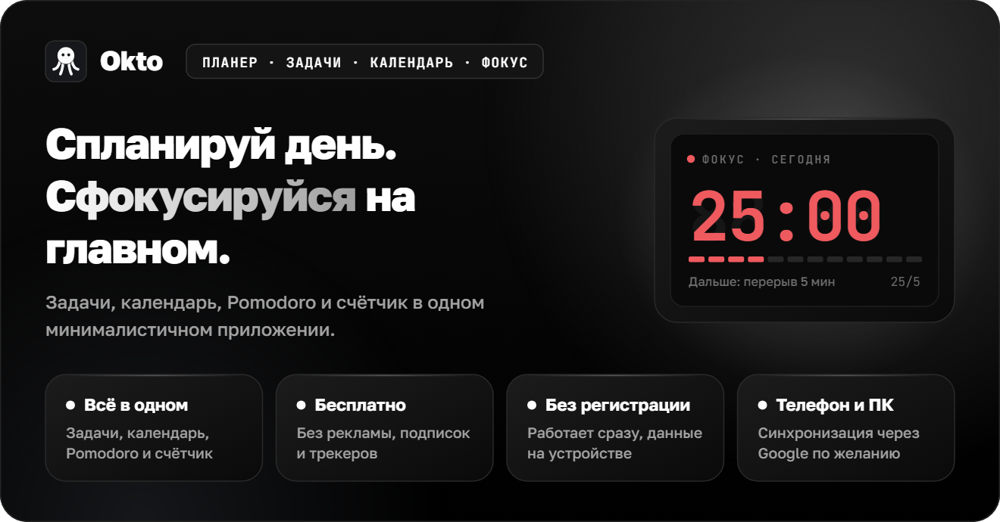
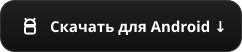
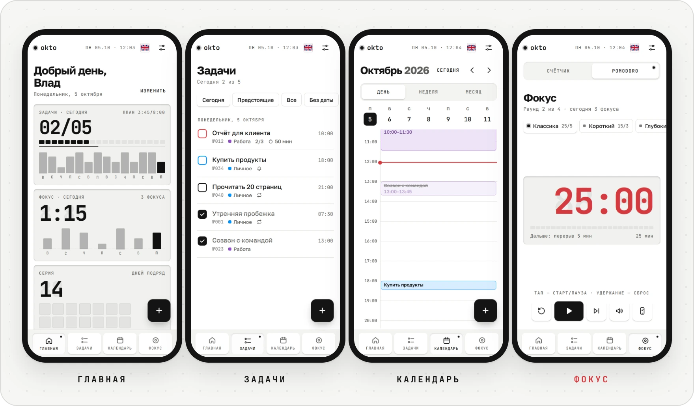
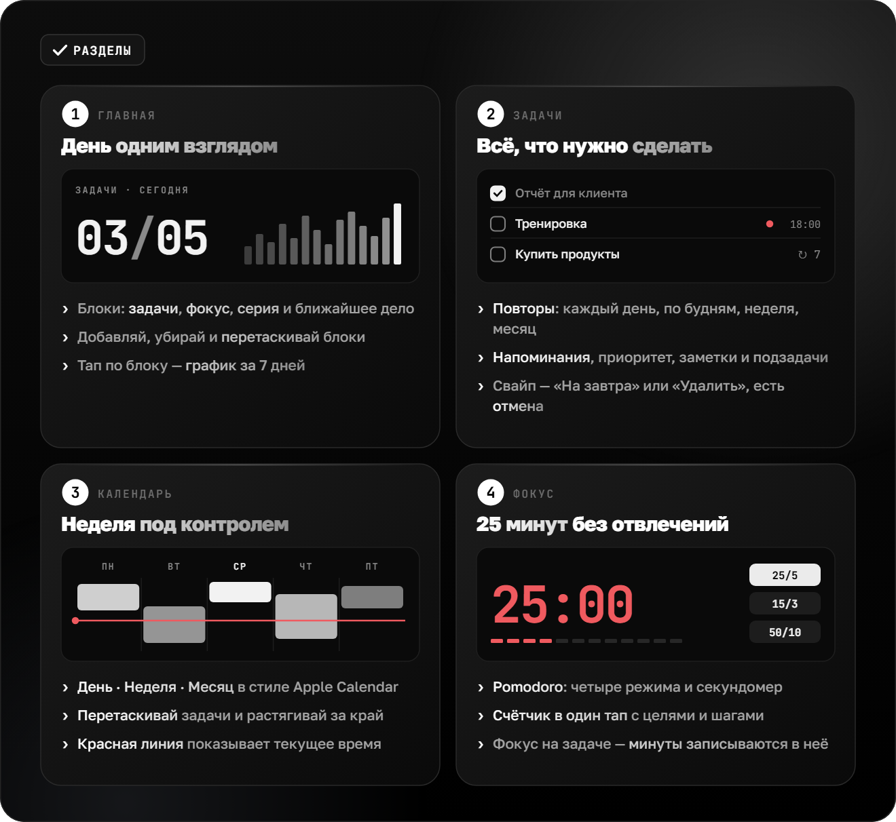
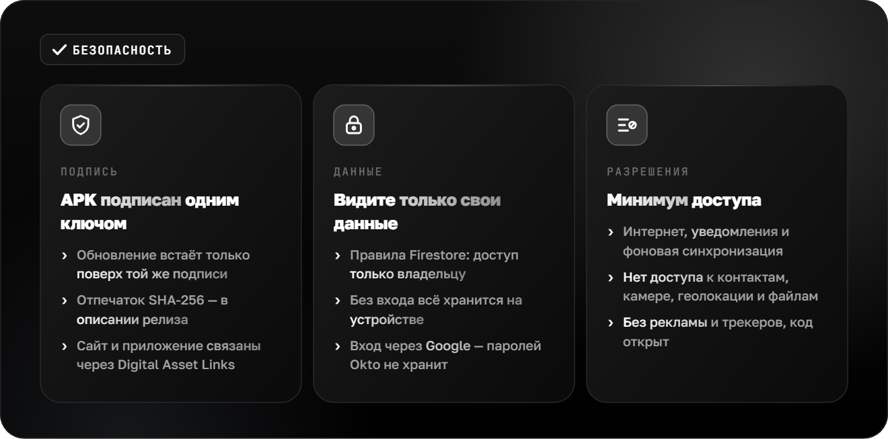

**Русский** · [English](README.md) · [Español](README.es.md) · [Português](README.pt.md) · [Deutsch](README.de.md) · [Français](README.fr.md) · [Italiano](README.it.md) · [Türkçe](README.tr.md) · [Українська](README.uk.md) · [Polski](README.pl.md)

 

<picture><source srcset="assets/readme/hero-ru.svg"></picture>

&nbsp;&nbsp;&nbsp;&nbsp;

**Okto работает на любом устройстве** — iPhone и Android, планшет, Windows, macOS и Linux. Нужен только браузер, а на телефон и компьютер Okto ставится как приложение. Для Android есть отдельное приложение с виджетом задач — его можно найти и в [Komi Store](https://github.com/komi-store/komi-store).

 

 

<picture><source srcset="assets/readme/sections-ru.svg"></picture>

 

Как включить синхронизацию

Без настройки Okto хранит всё в браузере на устройстве. Чтобы данные были одинаковыми на телефоне и компьютере, подключите бесплатный Firebase (план Spark, карта не нужна):

1. Создайте проект на [console.firebase.google.com](https://console.firebase.google.com/).
2. **Authentication → Sign-in method** — включите **Google**. В **Settings → Authorized domains** добавьте `sailxx.github.io`.
3. **Firestore Database** — создайте базу и во вкладке **Rules** вставьте содержимое [`firestore.rules`](firestore.rules).
4. **Project settings → Your apps → Web** — зарегистрируйте приложение и скопируйте `apiKey`, `authDomain`, `projectId`, `appId`.
5. В репозитории на GitHub: **Settings → Secrets and variables → Actions** — добавьте секреты `VITE_FIREBASE_API_KEY`, `VITE_FIREBASE_AUTH_DOMAIN`, `VITE_FIREBASE_PROJECT_ID`, `VITE_FIREBASE_APP_ID`.
6. Запустите деплой. В настройках Okto появится «Войти через Google».

Эти ключи не секретные — доступ защищают правила Firestore: каждый видит только свои данные. Напоминания на сайте срабатывают, пока вкладка открыта. В приложении для Android напоминания приходят, даже когда Okto закрыт.

 

<picture><source srcset="assets/readme/safe-ru.svg"></picture>

 

## 🗂 История версий

**3.0** — раздел «Заметки» с фото и файлами; новая главная: мягкие цветные карточки и вкладки «Сегодня / Неделя / Итоги»; плавающие панели навигации и сворачиваемая боковая панель на ПК; настройки со сворачиваемыми разделами; обновлённый «Фокус»; исправлены виджеты на Android.

**2.2–2.8** — значок на выбор; фото и файлы в задачах, офлайн-запуск; сворачиваемый месяц в календаре; напоминания о задачах на Android; задачи в Google Календаре; 14 новых светлых и тёмных тем; размер текста и три новых виджета; карта активности на главной.

**2.1** — Android-приложение с виджетом задач на рабочем столе; мягкие светлая и тёмная темы в стиле Apple; разделы «Созвоны» и «Фокус» можно скрыть; язык меняется в настройках; исправлен запуск на Android.

**2.0** — задачи со списками, повторами, подзадачами и напоминаниями; календарь в стиле Apple Calendar с перетаскиванием; главная с настраиваемыми блоками; синхронизация через Firebase; фокус на задаче.

**1.0** — Pomodoro с четырьмя режимами, теги-заготовки с цветами, семь тем, английский язык, уведомления в браузере.

## ⚖️ Лицензии

Шрифт [Inter](https://rsms.me/inter/) распространяется по лицензии SIL Open Font License 1.1. Картинки README набраны шрифтом [JetBrains Mono](https://github.com/JetBrains/JetBrainsMono) (OFL 1.1) + [Golos Text](https://github.com/googlefonts/golos-text) (OFL 1.1).
