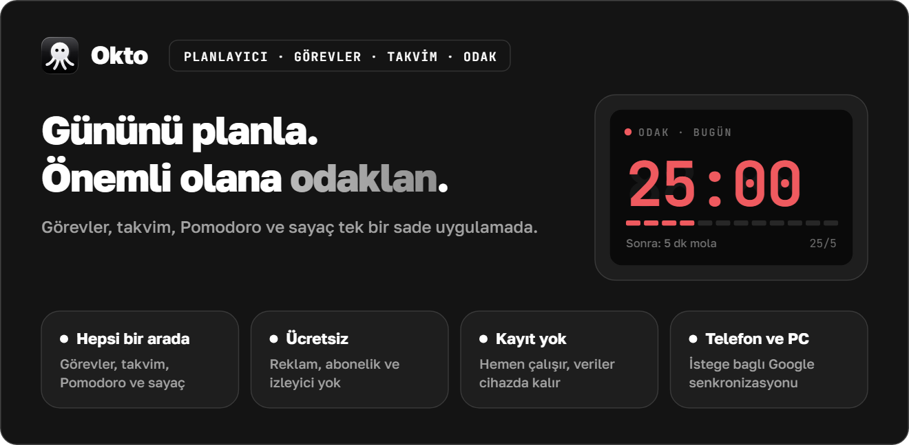
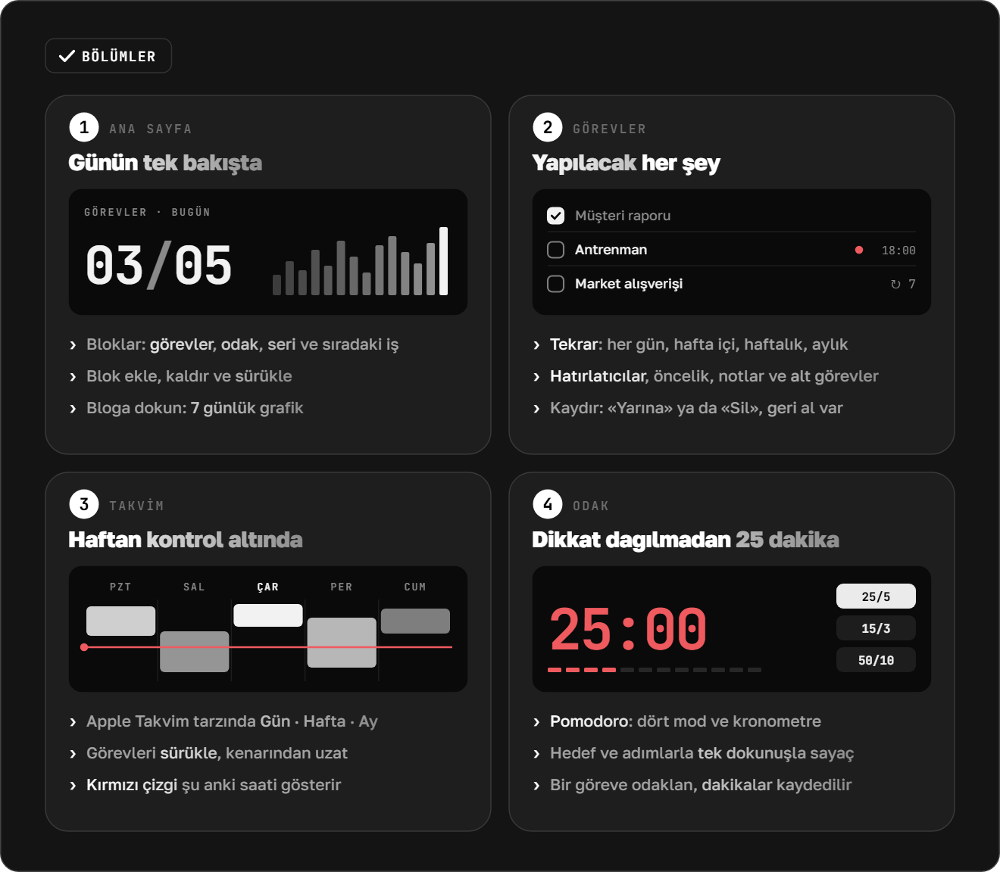
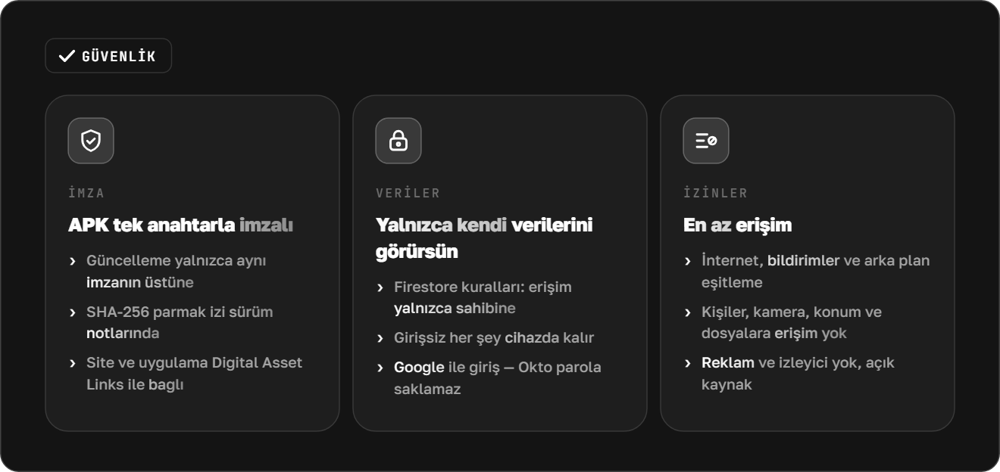

[English](README.md) · [العربية](README.ar.md) · [简体中文](README.zh-CN.md) · [繁體中文](README.zh-TW.md) · [Čeština](README.cs.md) · [Français](README.fr.md) · [Deutsch](README.de.md) · [Ελληνικά](README.el.md) · [Bahasa Indonesia](README.id.md) · [Gaeilge](README.ga.md) · [Italiano](README.it.md) · [日本語](README.ja.md) · [한국어](README.ko.md) · [Polski](README.pl.md) · [Română](README.ro.md) · [Русский](README.ru.md) · [Español](README.es.md) · [Українська](README.uk.md) · [اردو](README.ur.md) · [ئۇيغۇرچە](README.ug.md) · [Tiếng Việt](README.vi.md) · [Português](README.pt.md) · **Türkçe**

 

<picture><source srcset="assets/readme/hero-tr.svg"></picture>

&nbsp;&nbsp;&nbsp;&nbsp;

**Okto her cihazda çalışır** — iPhone ve Android, tablet, Windows, macOS ve Linux. Bir tarayıcı yeterli; telefona ve bilgisayara uygulama olarak da kurulur. Android için görev widget'lı ayrı bir uygulama da var; [Komi Store](https://github.com/komi-store/komi-store)'da da bulabilirsin.

> [!NOTE]
> Uygulama arayüzü Rusça ve İngilizcedir.

 

 

<picture><source srcset="assets/readme/sections-tr.svg"></picture>

 

Senkronizasyonu açma

Okto varsayılan olarak her şeyi cihazdaki tarayıcıda tutar. Telefonda ve bilgisayarda aynı verilere sahip olmak için ücretsiz bir Firebase projesi bağla (Spark planı, kart gerekmez):

1. [console.firebase.google.com](https://console.firebase.google.com/) adresinde bir proje oluştur.
2. **Authentication → Sign-in method** — **Google**’ı aç. **Settings → Authorized domains** altına `sailxx-apps.github.io` ekle.
3. **Firestore Database** — veritabanını oluştur ve **Rules** sekmesine [`firestore.rules`](firestore.rules) içeriğini yapıştır.
4. **Project settings → Your apps → Web** — uygulamayı kaydet ve `apiKey`, `authDomain`, `projectId`, `appId` değerlerini kopyala.
5. GitHub deposunda: **Settings → Secrets and variables → Actions** — `VITE_FIREBASE_API_KEY`, `VITE_FIREBASE_AUTH_DOMAIN`, `VITE_FIREBASE_PROJECT_ID`, `VITE_FIREBASE_APP_ID` secret’larını ekle.
6. Yayınlamayı başlat. Okto ayarlarında «Google ile giriş yap» görünür.

Bu anahtarlar gizli değildir: erişimi Firestore kuralları korur, herkes yalnızca kendi verisini görür. Sitedeki hatırlatıcılar sekme açıkken çalışır. Android uygulamasında hatırlatıcılar Okto kapalıyken de gelir.

 

<picture><source srcset="assets/readme/safe-tr.svg"></picture>

 

## Okto hakkında

<picture><source srcset="assets/readme/about-tr.svg"></picture>

Okto, 2 Ekim 2026’da basit bir web sayacı olarak başladı. Bugün görevler, takvim ve odaklanma için ücretsiz bir planlayıcı. Reklam, analiz veya takip yazılımı yok. Kayıtlar cihazında kalır ve Google Firebase ile eşitleme isteğe bağlıdır. [Güvenlik: imza, veriler, izinler](PRIVACY.md)

## Yol haritası

<picture><source srcset="assets/readme/roadmap-tr.svg"></picture>

**2026-10-02** — İlk Okto, hedef ve kronometre içeren tek dokunuşlu bir sayaçtı.

**1.0** — dört modlu Pomodoro, renkli hazır etiketler, yedi tema, İngilizce, tarayıcı bildirimleri.

**2.0** — listeli, tekrarlı, alt görevli ve hatırlatıcılı görevler; sürükle-bırak destekli Apple Takvim tarzı takvim; özelleştirilebilir ana sayfa; Firebase senkronizasyonu; göreve odaklanma.

**2.1** — ana ekran görev widget'lı Android uygulaması; Apple tarzı yumuşak açık ve koyu temalar; Aramalar ve Odak gizlenebilir; dil Ayarlar'da; Android'de açılış düzeltildi.

**2.2–2.8** — seçilebilir uygulama simgesi; görevlerde fotoğraf ve dosyalar, çevrimdışı açılış; takvimde daraltılabilir ay; Android'de görev hatırlatıcıları; Google Takvim'de görevler; 14 yeni açık ve koyu tema; yazı boyutu ve üç yeni widget; ana sayfada etkinlik haritası.

**3.0** — fotoğraf ve dosya ekleyebileceğiniz Notlar bölümü; yumuşak renkli kartlar ve Bugün / Hafta / Toplam sekmeleriyle yeni Ana sayfa; yüzen gezinme çubukları ve masaüstünde daraltılabilir kenar çubuğu; daraltılabilir bölümlü ayarlar; yenilenen Odak; Android widget düzeltmeleri.

[**3.23.6**](https://github.com/sailxx/Okto/releases/tag/v3.23.6) — Okto, Windows bildirim alanına geldi. Android planlayıcı çevrimdışı açılıyor. 3.23.6 sürümü ekleri ve odak ekranını iyileştiriyor.

## ⚖️ Lisanslar

[Inter](https://rsms.me/inter/) yazı tipi SIL Open Font License 1.1 ile lisanslıdır. README görselleri [JetBrains Mono](https://github.com/JetBrains/JetBrainsMono) (OFL 1.1) + [Golos Text](https://github.com/googlefonts/golos-text) (OFL 1.1) ile dizilmiştir.
