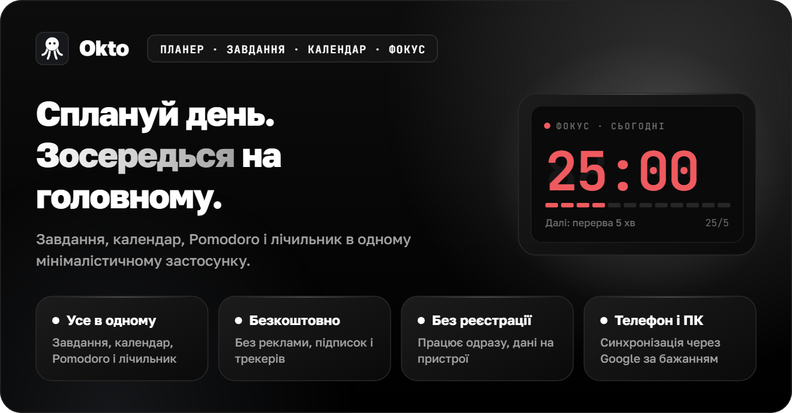
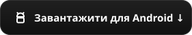
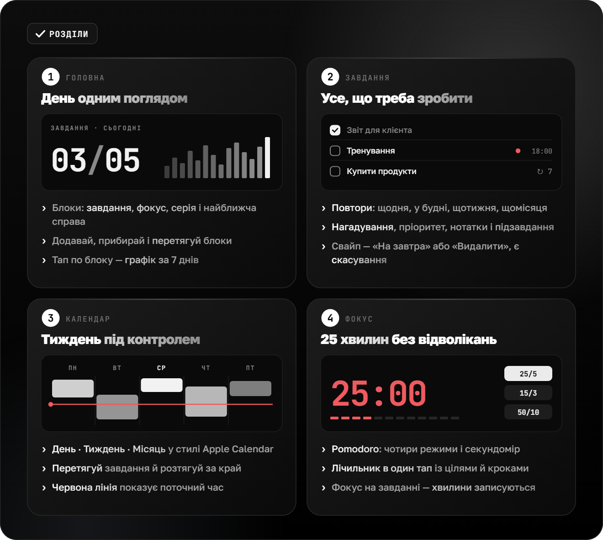
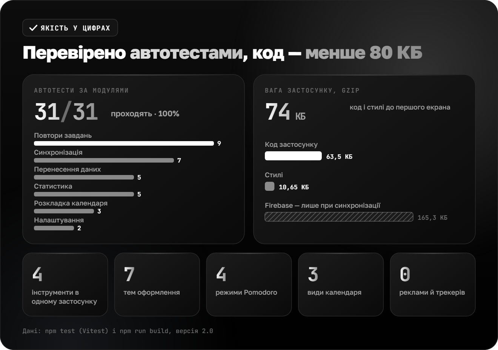
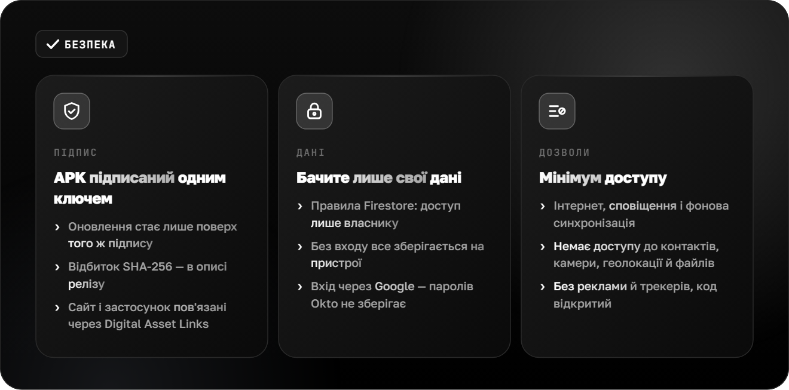

[Русский](README.md) · [English](README.en.md) · [Español](README.es.md) · [Português](README.pt.md) · [Deutsch](README.de.md) · [Français](README.fr.md) · [Italiano](README.it.md) · [Türkçe](README.tr.md) · **Українська** · [Polski](README.pl.md)

 

<picture><source srcset="assets/readme/hero-uk.svg"></picture>

&nbsp;&nbsp;

**Okto працює на будь-якому пристрої** — iPhone і Android, планшет, Windows, macOS і Linux. Потрібен лише браузер, а на телефон і комп'ютер Okto встановлюється як застосунок. Для Android є окремий застосунок із віджетом завдань — його можна знайти й у [Komi Store](https://github.com/komi-store/komi-store).

> [!NOTE]
> Інтерфейс застосунку доступний російською та англійською.

 

 

<picture><source srcset="assets/readme/sections-uk.svg"></picture>

 

<picture><source srcset="assets/readme/quality-uk.svg"></picture>

 

Як увімкнути синхронізацію

Без налаштування Okto зберігає все в браузері на пристрої. Щоб дані були однаковими на телефоні й комп’ютері, підключіть безкоштовний Firebase (план Spark, картка не потрібна):

1. Створіть проєкт на [console.firebase.google.com](https://console.firebase.google.com/).
2. **Authentication → Sign-in method** — увімкніть **Google**. У **Settings → Authorized domains** додайте `sailxx.github.io`.
3. **Firestore Database** — створіть базу й у вкладці **Rules** вставте вміст [`firestore.rules`](firestore.rules).
4. **Project settings → Your apps → Web** — зареєструйте застосунок і скопіюйте `apiKey`, `authDomain`, `projectId`, `appId`.
5. У репозиторії на GitHub: **Settings → Secrets and variables → Actions** — додайте секрети `VITE_FIREBASE_API_KEY`, `VITE_FIREBASE_AUTH_DOMAIN`, `VITE_FIREBASE_PROJECT_ID`, `VITE_FIREBASE_APP_ID`.
6. Запустіть деплой. У налаштуваннях Okto з’явиться «Увійти через Google».

Ці ключі не секретні — доступ захищають правила Firestore: кожен бачить лише свої дані. Нагадування на сайті спрацьовують, поки вкладка відкрита. У застосунку для Android нагадування приходять, навіть коли Okto закритий.

 

<picture><source srcset="assets/readme/safe-uk.svg"></picture>

 

## 🗂 Історія версій

**3.0** — розділ «Нотатки» з фото та файлами; нова головна з м’якими кольоровими картками й вкладками «Сьогодні / Тиждень / Підсумки»; плаваючі панелі навігації та згортувана бічна панель на ПК; налаштування зі згортуваними розділами; оновлений «Фокус»; виправлені віджети на Android.

**2.2–2.8** — значок на вибір; фото й файли в завданнях, запуск офлайн; згортуваний місяць у календарі; нагадування про завдання на Android; завдання в Google Календарі; 14 нових світлих і темних тем; розмір тексту й три нові віджети; карта активності на головній.

**2.1** — Android-застосунок із віджетом завдань на робочому столі; м'які світла й темна теми в стилі Apple; «Дзвінки» і «Фокус» можна сховати; мова — в налаштуваннях; виправлено запуск на Android.

**2.0** — завдання зі списками, повторами, підзавданнями й нагадуваннями; календар у стилі Apple Calendar з перетягуванням; головна з налаштовуваними блоками; синхронізація через Firebase; фокус на завданні.

**1.0** — Pomodoro з чотирма режимами, теги-заготовки з кольорами, сім тем, англійська мова, сповіщення в браузері.

## ⚖️ Ліцензії

Шрифт [Inter](https://rsms.me/inter/) поширюється за ліцензією SIL Open Font License 1.1. Зображення README набрані шрифтом [JetBrains Mono](https://github.com/JetBrains/JetBrainsMono) (OFL 1.1) + [Golos Text](https://github.com/googlefonts/golos-text) (OFL 1.1).
