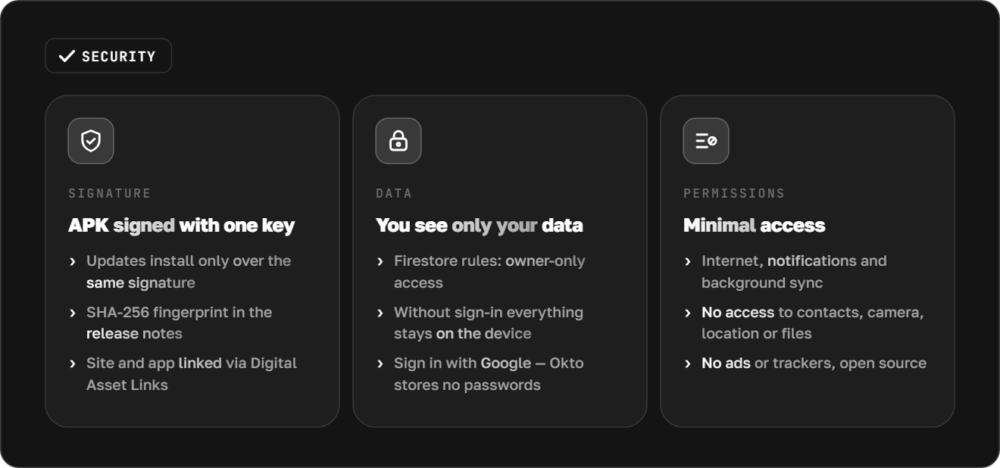

[English](README.md) · [العربية](README.ar.md) · [简体中文](README.zh-CN.md) · [繁體中文](README.zh-TW.md) · [Čeština](README.cs.md) · [Français](README.fr.md) · [Deutsch](README.de.md) · [Ελληνικά](README.el.md) · [Bahasa Indonesia](README.id.md) · [Gaeilge](README.ga.md) · [Italiano](README.it.md) · [日本語](README.ja.md) · [한국어](README.ko.md) · [Polski](README.pl.md) · [Română](README.ro.md) · [Русский](README.ru.md) · [Español](README.es.md) · [Українська](README.uk.md) · **اردو** · [ئۇيغۇرچە](README.ug.md) · [Tiếng Việt](README.vi.md) · [Português](README.pt.md) · [Türkçe](README.tr.md)

 

<picture><source srcset="assets/readme/hero-en.svg"></picture>

&nbsp; &nbsp;&nbsp; &nbsp;

**Okto کسی بھی ڈیوائس پر کام کرتا ہے۔** — iPhone اور Android، گولیاں، Windows، macOS اور Linux۔ آپ کو صرف ایک براؤزر کی ضرورت ہے، اور Okto آپ کے فون یا کمپیوٹر پر ایپ کے بطور انسٹال ہوتا ہے۔ Android کو ٹاسک ویجیٹ کے ساتھ ایک سرشار ایپ بھی ملتی ہے — آپ اسے اس میں تلاش کر سکتے ہیں۔ [کومی اسٹور](https://github.com/komi-store/komi-store) بھی

> [!NOTE]
> ایپ انٹرفیس روسی اور انگریزی میں دستیاب ہے۔

Android APK منصوبہ ساز کو آف لائن کھولتا ہے، بشمول پہلی لانچ پر۔ مطابقت پذیر ڈیٹا اور ظاہری شکل کی ترتیبات کو بحال کرنے کے لیے اسی Google اکاؤنٹ سے سائن ان کریں۔ صرف پرانے براؤزر ایپ میں ذخیرہ کردہ ڈیٹا اور منسلکات وہاں دستیاب رہتے ہیں۔

 

 

<picture><source srcset="assets/readme/sections-en.svg"></picture>

 

مطابقت پذیری کو کیسے آن کریں۔

آؤٹ آف دی باکس Okto آپ کے آلے پر براؤزر میں موجود ہر چیز کو رکھتا ہے۔ فون اور کمپیوٹر پر ایک جیسا ڈیٹا رکھنے کے لیے، ایک مفت Firebase پروجیکٹ کو جوڑیں (اسپارک پلان، کارڈ کی ضرورت نہیں):

1. پر ایک پروجیکٹ بنائیں [console.firebase.google.com](https://console.firebase.google.com/).
2. **تصدیق → سائن ان کا طریقہ** — فعال کریں **گوگل**. میں **ترتیبات → مجاز ڈومینز** شامل کریں `sailxx-apps.github.io`.
3. **فائر اسٹور ڈیٹا بیس** — ایک ڈیٹا بیس بنائیں اور پیسٹ کریں۔ [`firestore.rules`](firestore.rules) میں **قواعد** ٹیب
4. **پروجیکٹ کی ترتیبات → آپ کی ایپس → ویب** — ایپ کو رجسٹر کریں اور کاپی کریں۔ `apiKey`, `authDomain`, `projectId`, `appId`.
5. GitHub ریپو میں: **ترتیبات → راز اور متغیرات → اعمال** — راز شامل کریں `VITE_FIREBASE_API_KEY`, `VITE_FIREBASE_AUTH_DOMAIN`, `VITE_FIREBASE_PROJECT_ID`, `VITE_FIREBASE_APP_ID`.
6. تعیناتی کو چلائیں۔ "Google کے ساتھ سائن ان کریں" Okto کی ترتیبات میں ظاہر ہوتا ہے۔

یہ کلیدیں خفیہ نہیں ہیں — رسائی Firestore کے قوانین کے ذریعے محفوظ ہے، لہذا ہر کوئی صرف اپنا ڈیٹا دیکھتا ہے۔ ویب سائٹ پر یاد دہانیاں اس وقت فائر ہوجاتی ہیں جب ٹیب کھلا ہو۔ Android ایپ میں، Okto بند ہونے پر بھی یاد دہانیاں آتی ہیں۔

 

<picture><source srcset="assets/readme/safe-en.svg"></picture>

 

## Okto کے بارے میں

<picture><source srcset="assets/readme/about-en.svg"></picture>

Okto 2 اکتوبر 2026 کو ایک سادہ ویب کاؤنٹر کے طور پر شروع ہوا۔ یہ کاموں، کیلنڈرز اور فوکس کے لیے ایک مفت منصوبہ ساز بن گیا۔ کوئی اشتہارات، تجزیات، یا ٹریکرز نہیں ہیں۔ آپ کے اندراجات آپ کے آلے پر رہتی ہیں، اور آپ Google Firebase کے ذریعے مطابقت پذیری کے لیے آپٹ ان کر سکتے ہیں۔ [سیکورٹی: دستخط، ڈیٹا، اجازت](PRIVACY.md)

## روڈ میپ

<picture><source srcset="assets/readme/roadmap-en.svg"></picture>

**2026-10-02** — پہلا Okto ہدف اور سٹاپ واچ کے ساتھ ون ٹیپ کاؤنٹر تھا۔

**1.0** — پومودورو چار طریقوں، رنگین پیش سیٹ ٹیگز، سات تھیمز، انگریزی زبان، براؤزر اطلاعات کے ساتھ۔

**2.0** — فہرستوں، تکرار، ذیلی کاموں اور یاد دہانیوں کے ساتھ کام؛ ڈریگ اینڈ ڈراپ کے ساتھ ایپل کیلنڈر اسٹائل کیلنڈر؛ ایک مرضی کے مطابق ہوم اسکرین؛ فائر بیس مطابقت پذیری؛ ایک کام پر توجہ مرکوز کریں.

**2.1** — ہوم اسکرین ٹاسک ویجیٹ کے ساتھ Android ایپ؛ ایپل سٹائل میں نرم روشنی اور تاریک تھیمز؛ کالز اور فوکس کو چھپایا جا سکتا ہے۔ زبان سیٹنگز میں سیٹ کی گئی ہے۔ Android پر فکسڈ لانچنگ۔

**2.2–2.8** — ایپ کا آئیکن منتخب کریں؛ کاموں میں تصاویر اور فائلیں، آف لائن لانچ؛ کیلنڈر میں ٹوٹنے والا مہینہ؛ Android پر کام کی یاددہانی؛ گوگل کیلنڈر میں کام؛ 14 نئے روشنی اور تاریک تھیمز؛ متن کا سائز اور تین نئے ویجٹ؛ ہوم اسکرین پر سرگرمی کا نقشہ۔

**3.0** — تصاویر اور فائلوں کے ساتھ ایک نوٹس سیکشن؛ نرم رنگ کے کارڈز اور آج / ہفتہ / ٹوٹل ٹیبز کے ساتھ ایک نیا گھر؛ تیرتے نیویگیشن بارز اور ڈیسک ٹاپ پر ٹوٹنے والی سائڈبار؛ ٹوٹنے کے قابل حصوں کے ساتھ ترتیبات؛ ایک تازہ دم فوکس اسکرین؛ Android ویجیٹ کی اصلاحات۔

[**3.23.6**](https://github.com/sailxx/Okto/releases/tag/v3.23.6) — Okto نے Windows ٹرے ایپ حاصل کی۔ Android پلانر آف لائن کھلتا ہے، اور 3.23.6 منسلکات اور فوکس اسکرین کو بہتر بناتا ہے۔

## ⚖️ لائسنس

دی [انٹر](https://rsms.me/inter/) فونٹ SIL اوپن فونٹ لائسنس 1.1 کے تحت لائسنس یافتہ ہے۔ README تصاویر ترتیب دی گئی ہیں۔ [JetBrains Mono](https://github.com/JetBrains/JetBrainsMono) (OFL 1.1) + [Golos Text](https://github.com/googlefonts/golos-text) (OFL 1.1).
